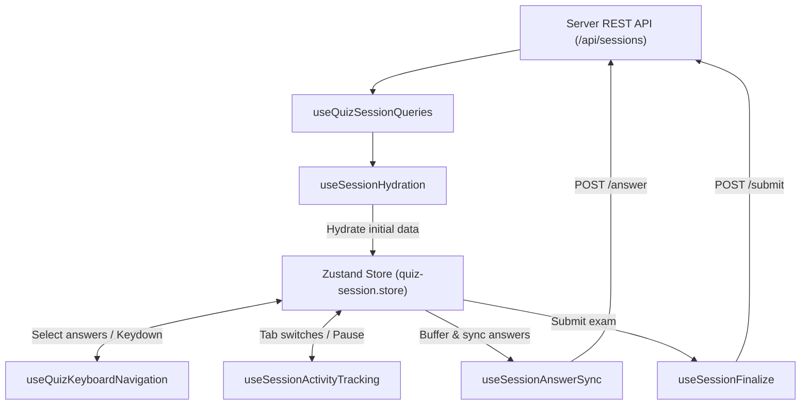

# 🪝 Custom React Hooks (`hooks/`)

Technical specification for all **Custom React Hooks** in **FQuiz**, integrating **TanStack React Query v5**, **Zustand Client State**, hardware-accelerated animations, keyboard navigation, and session optimization.

---

## 1. Directory Structure

```
hooks/
├── auth/
│   └── useAuth.ts                    # User session, role authorization, and claims
├── quiz/                              # Exam room & authoring hooks
│   ├── useAnimationPreference.ts      # Checks prefers-reduced-motion OS preference
│   ├── useFlashcardSession.ts         # Coordinates 3D vocabulary flashcard sessions
│   ├── useMobileQuizSessionController.ts # Mobile touch gesture and layout controller
│   ├── usePinnedQuestions.ts          # Pinned question management and review quiz generator
│   ├── useQuestionBankCheck.ts        # Duplicate question detection against question bank
│   ├── useQuestionBankWarning.ts      # Real-time answer conflict warning during authoring
│   ├── useQuizKeyboardNavigation.ts   # Keyboard navigation (1-4, Arrows, Enter, Space)
│   ├── useQuizSessionQueries.ts       # TanStack Query fetchers for session and questions
│   ├── useSessionActivityTracking.ts  # Focus, tab switching, and pause/resume tracking
│   ├── useSessionAnswerSync.ts        # Background synchronization of answers to server
│   ├── useSessionFinalize.ts          # Exam submission and result navigation
│   ├── useSessionHydration.ts         # Server-to-Zustand store session hydration
│   └── useSubmitAnswer.ts             # Mutation hook for individual question answers
├── shared/
│   └── useDebounce.ts                 # Generic value and function debounce hook
├── useCommunityFeed.ts                # Community discussions, comments, and votes
├── useLogout.ts                       # Logout handler, cookie clearing, and cache purge
├── useMixQuizGenerator.ts             # Mixed quiz generation across multiple sets
├── useQuizEditor.ts                   # Authoring editor state and auto-save coordination
├── useStudentClassrooms.ts            # Student classroom queries and join actions
├── useStudentDashboard.ts             # Student learning metrics, streaks, and active sessions
├── useTeacherClassrooms.ts            # Teacher classroom management and assignment distribution
└── useTeacherQuizzes.ts               # Teacher quiz selection for classroom assignments
```

---

## 2. Quiz Session Data Flow

Hooks under `hooks/quiz/` coordinate in a cohesive lifecycle:



---

## 3. Key Hooks Breakdown

### 3.1. `useSessionHydration` & `useSessionAnswerSync`
- **Hydration**: When the exam room loads, initial session details and question arrays are hydrated from TanStack Query into Zustand, providing instant 0ms question switching.
- **Answer Sync**: Student selections update the Zustand store optimistically before transmitting a background `POST /api/sessions/[id]/answer` with automatic retry on transient network drops.

### 3.2. `useQuizKeyboardNavigation`
Enables desktop keyboard shortcuts:
- Keys `1`, `2`, `3`, `4`: Select options A, B, C, D.
- Keys `ArrowLeft` / `ArrowRight`: Navigate to previous / next question.
- Keys `Space` / `F`: Toggle question flag for review.
- Key `Enter`: Open submission confirmation modal on the final question.

### 3.3. `useSessionActivityTracking`
- Listens to browser `visibilitychange` events (detecting tab switches or window minimization).
- Pauses timers during system dialogs or user-initiated pause states.
- Periodically reports telemetry to `/api/sessions/[id]/activity` to maintain exam integrity.

---

## 4. Development Standards

1. **Dependency Inversion**: Server mutations must never be invoked directly in components; always wrap mutations in TanStack Query hooks.
2. **Cleanup Guarantees**: Window event listeners (keyboard, activity tracking, timers) must return clean teardown handlers upon unmount.
3. **Memoization**: Handlers and returned state bags must be memoized using `useCallback` and `useMemo` to prevent unwanted child re-renders.
