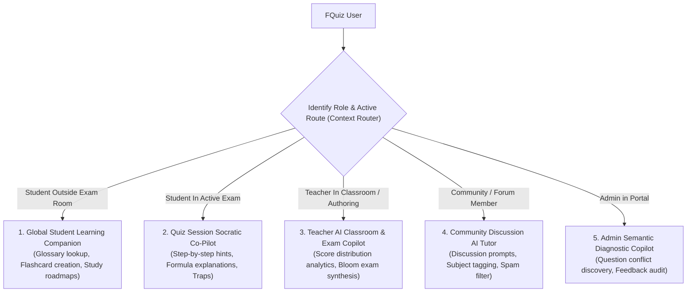
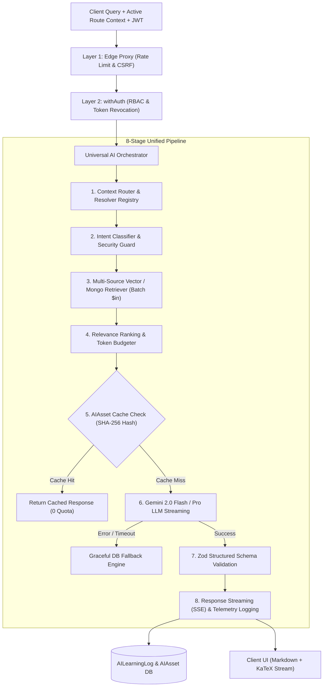
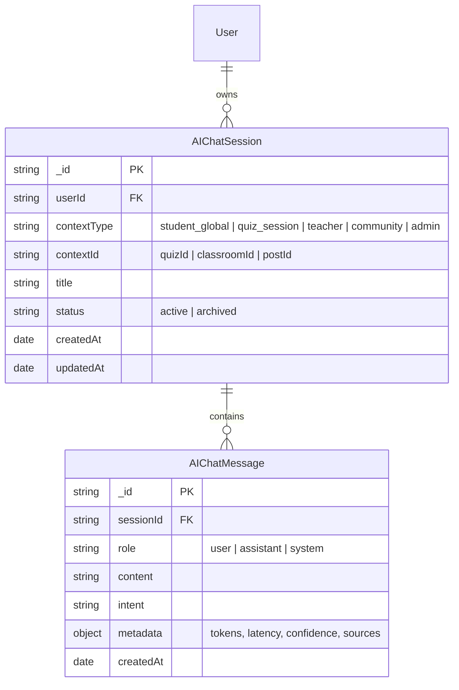
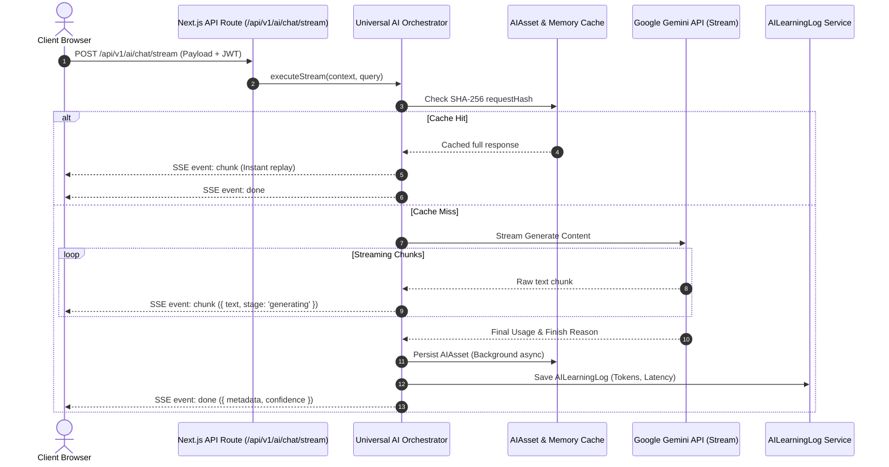
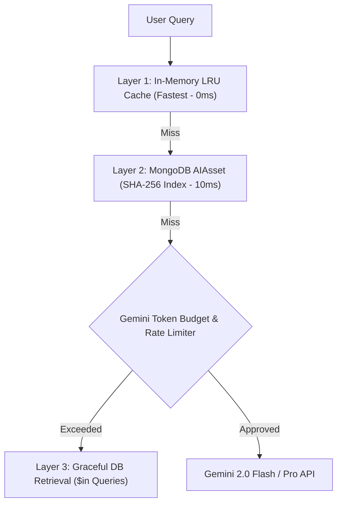
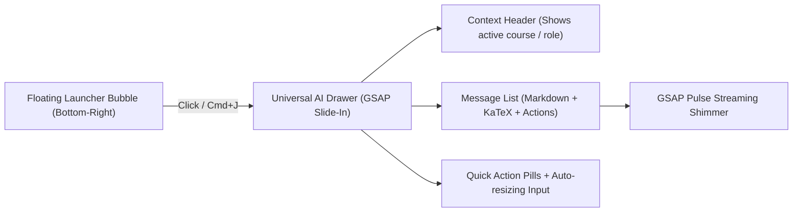
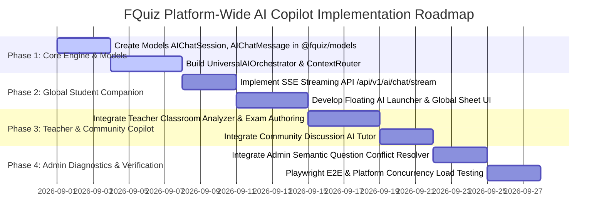

# 🤖 Comprehensive AI Chatbot Architecture Specification: FQuiz (Platform-Wide AI Copilot Specification)

> **Document**: FQuiz Platform-Wide AI Copilot & Learning Companion Architecture  
> **Version**: 3.0.0 (Master Architecture Spec)  
> **Approval Date**: 2026-08-29  
> **Scope**: Entire FQuiz Monorepo ecosystem (`apps/web`, `apps/admin`, `packages/models`, `packages/database`, `packages/auth`, `packages/ui`).  
> **Core Vision**: Elevate the AI Assistant from a localized in-exam helper (`QuizAIAssistantDrawer`) into an **Omnipresent Multi-Context AI Copilot** serving Students, Teachers, Community Members, and System Administrators.

---

## 📑 TABLE OF CONTENTS

1. [Section 1: Background, Motivation & Mission Statement](#section-1-background-motivation--mission-statement)
2. [Section 2: 5-Context Matrix Across User Personas](#section-2-5-context-matrix-across-user-personas)
3. [Section 3: System Architecture: Universal AI Orchestrator & Context Router](#section-3-system-architecture-universal-ai-orchestrator--context-router)
4. [Section 4: 6 Mandatory Architectural Invariants](#section-4-6-mandatory-architectural-invariants)
5. [Section 5: Detailed Specifications for 5 AI Copilot Subsystems](#section-5-detailed-specifications-for-5-ai-copilot-subsystems)
   - [5.1. 🎓 Global Student Learning Companion](#51--global-student-learning-companion)
   - [5.2. 📝 Quiz Session Socratic Co-Pilot](#52--quiz-session-socratic-co-pilot)
   - [5.3. 👨‍🏫 Teacher AI Classroom & Exam Copilot](#53--teacher-ai-classroom--exam-copilot)
   - [5.4. 👥 Community Discussion & Moderation AI Tutor](#54--community-discussion--moderation-ai-tutor)
   - [5.5. 🛡️ Admin Semantic Diagnostic & Moderation Copilot](#55--admin-semantic-diagnostic--moderation-copilot)
6. [Section 6: Data Model Evolution & Extended Schemas (`packages/models`)](#section-6-data-model-evolution--extended-schemas-packagesmodels)
7. [Section 7: Streaming Protocol (SSE) & Conversation Management](#section-7-streaming-protocol-sse--conversation-management)
8. [Section 8: Cost Optimization, Multi-Tier Caching & Token Budgeting](#section-8-cost-optimization-multi-tier-caching--token-budgeting)
9. [Section 9: UI/UX Design, GSAP Micro-Animations & Accessibility (a11y)](#section-9-uiux-design-gsap-micro-animations--accessibility-a11y)
10. [Section 10: 4-Phase Implementation Roadmap & Testing Matrix](#section-10-4-phase-implementation-roadmap--testing-matrix)

---

## SECTION 1: BACKGROUND, MOTIVATION & MISSION STATEMENT

### 1.1. Current State Analysis
- The existing AI Assistant is constrained **exclusively within active quiz session screens** (`apps/web/components/quiz/session/QuizAIAssistantDrawer.tsx`).
- While the platform possesses 11 standalone prompt templates (`vocabulary`, `grammar`, `sentence`, `quiz`, `flashcard`, `translation`, etc.), these operate as static form generators lacking conversational memory, cross-screen awareness, and state persistence.
- Teachers, students outside active exams, community discussion participants, and platform administrators lack unified conversational AI tools to assist their daily workflows.

### 1.2. Target Vision
Construct the **FQuiz Universal AI Copilot** as a context-aware intelligent companion adapting dynamically based on user role (Role-Aware) and active route location (Route-Aware):
- **For Students**: A 24/7 personal tutor explaining complex concepts, generating interactive flashcards and practice quizzes directly from conversations, and synthesizing customized study schedules.
- **For Teachers**: A pedagogical assistant analyzing score distributions, detecting classroom knowledge gaps, and drafting Bloom-aligned exams for direct ingestion into the question bank.
- **For Community Forums**: An academic advisor proposing structured answers, tagging course codes, and shielding discussions from spam and toxicity.
- **For Administrators**: An operations assistant detecting semantic duplicate questions in `QuestionBank`, summarizing user feedback, and monitoring token utilization.

---

## SECTION 2: 5-CONTEXT MATRIX ACROSS USER PERSONAS



| Context | Target Persona | Trigger Location | Core Mission & Key Capabilities |
|---|---|---|---|
| **1. Global Student Companion** | Student / Guest | Platform-wide Web (`Floating Launcher` / `Cmd+J`) | Personal tutor: Explain terms, context translation, instant flashcard generation, 5-question quick review tests. |
| **2. Quiz Session Co-Pilot** | Active Examinee | Exam session room (`/quiz/[id]/session/[sessionId]`) | Socratic guidance: Deliver step-by-step hints without revealing answers, similar question retrieval. |
| **3. Teacher Copilot** | Teacher | Classroom management (`/teacher/classrooms/[id]`) & Quiz authoring | Pedagogical assistant: Analyze classroom score distributions, diagnose common mistakes, synthesize Bloom exams. |
| **4. Community AI Tutor** | Student & Teacher | Academic discussion forums (`/community/post/[id]`) | Community advisor: Summarize threads, propose starter solutions, auto-tag course codes. |
| **5. Admin Copilot** | Administrator | Admin Portal (`apps/admin/app/(dashboard)/`) | Operations copilot: Scan semantic question collisions in Question Bank, summarize feedback, track token burn. |

---

## SECTION 3: SYSTEM ARCHITECTURE: UNIVERSAL AI ORCHESTRATOR & CONTEXT ROUTER



### Module Layout Specification:
```
apps/web/lib/modules/ai/
├── core/
│   ├── universal-orchestrator.ts      # Multi-context orchestration engine
│   ├── context-router.ts              # Route and role-based context dispatcher
│   └── rate-limiter.ts                # Dedicated sliding-window rate limiter for AI
├── contexts/
│   ├── student-global.context.ts      # Context Resolver for platform-wide students
│   ├── quiz-session.context.ts        # Context Resolver for examination sessions
│   ├── teacher-classroom.context.ts   # Context Resolver for teachers & classrooms
│   ├── community-forum.context.ts     # Context Resolver for community forums
│   └── admin-diagnostic.context.ts    # Context Resolver for administrative portal
├── intents/
│   ├── intent-classifier.ts           # Intent classification engine (18 intent types)
│   └── intent-types.ts
├── prompts/
│   ├── templates/                     # 18 structured prompt templates
│   └── prompt-builder.ts              # Assembles system prompts + RAG context
├── streaming/
│   ├── sse-streamer.ts                # Server-Sent Events protocol handler
│   └── chunk-transformer.ts           # Formats Markdown and KaTeX stream chunks
└── telemetry/
    └── ai-telemetry.service.ts        # Logs token usage, latency metrics, and fallbacks
```

---

## SECTION 4: 6 MANDATORY ARCHITECTURAL INVARIANTS

1. **INVARIANT 1: Text-Only Learning Product Scope**:
   - All AI inputs and outputs are strictly constrained to: Natural language text, Code snippets, Mathematical/scientific formulas (KaTeX), Markdown tables, and structured JSON.
   - **AUDIO (TTS/STT), VIDEO, OCR, AND 3D/VR ARE STRICTLY PROHIBITED**.
2. **INVARIANT 2: Dual-Hash Deduplication (Zero Quota Waste)**:
   - Prior to dispatching prompts to LLM providers, compute a SHA-256 hash across `{ promptTemplate, contextData, userQuery }` as `requestHash`.
   - If an active entry exists in `AIAsset`, return the cached response immediately (0 API tokens consumed).
3. **INVARIANT 3: Graceful Database Fallback & Zero Disruption**:
   - When the Gemini API encounters errors (HTTP 429 Rate Limit, HTTP 503 Overload, or Timeout > 2500ms), `UniversalAIOrchestrator` triggers the Fallback Engine:
     - Retrieves similar items from `QuestionBank` or classroom progress via Mongo batch `$in` queries.
     - Returns structured system data seamlessly without severing the user's conversational flow.
4. **INVARIANT 4: Zero-Trust Context Isolation & RBAC**:
   - `ContextRouter` extracts only data accessible by the authenticated user (verified by `withAuth`).
   - Students cannot access unpublished teacher quizzes or peer exam results.
5. **INVARIANT 5: Streaming First Response Time < 400ms**:
   - Conversational interactions leverage Server-Sent Events (SSE). The initial text chunk must render in the UI within **< 400ms**.
6. **INVARIANT 6: Telemetry, Token Cost & Quality Tracking**:
   - 100% of AI requests log telemetry into `AILearningLog`: Token counts (Prompt + Completion), stage execution durations, Confidence Score, and Fallback state.

---

## SECTION 5: DETAILED SPECIFICATIONS FOR 5 AI COPILOT SUBSYSTEMS

### 5.1. 🎓 Global Student Learning Companion
- **Trigger**: Fixed floating launcher button at the bottom-right of the screen across all student routes, opening the Global Chat Drawer (`Ctrl + J` / `Cmd + J`).
- **Core Capabilities**:
  1. **Concept & Glossary Explanations**: Identifies the course subject in view (via URL `course_code` or `category_id`) to provide targeted definitions.
  2. **Instant Flashcard Generation**: Students can request: *"Create 5 flashcards on Present Perfect tense"*. The bot produces 5 double-sided cards with a one-click **"Save to My Flashcards"** action (`POST /api/student/flashcards`).
  3. **Interactive 5-Question Mini-Quizzes**: Generates instant interactive practice quizzes directly within the chat stream.
  4. **Personalized Study Roadmaps**: Inspects recent examination history (`QuizSession`), detects the 3 lowest-scoring subjects, and plans a 7-day review schedule.

### 5.2. 📝 Quiz Session Socratic Co-Pilot
- **Trigger**: Embedded right drawer within active quiz sessions (`apps/web/components/quiz/session/QuizAIAssistantDrawer.tsx`).
- **Core Capabilities**:
  1. **Socratic Guidance**: When asked for answers, the AI refrains from providing options (A/B/C/D); instead, it poses guiding questions and restates relevant theorems.
  2. **Trap Warnings**: Alerts students to common misconceptions present in the active question stem.
  3. **Similar Question Lookup**: Retrieves a comparable illustrative question from `QuestionBank` demonstrating similar methodology.

### 5.3. 👨‍🏫 Teacher AI Classroom & Exam Copilot
- **Trigger**: Integrated within classroom management (`teacher/classrooms/[id]`) and exam authoring routes (`teacher/quizzes/create`).
- **Core Capabilities**:
  1. **Score Distribution & Gap Analysis**:
     - Audits `QuizAssignmentProgress` across the entire classroom.
     - Synthesizes findings: *"35% of students failed Question 4 (Nested Conditionals in C++)"*.
     - Proposes: *"Dedicate 15 minutes at the start of next class to review branching logic"*.
  2. **Bloom-Taxonomy Exam Authoring**:
     - Instructors input: *"Generate 20 calculus questions on integration by parts: 40% Recall, 30% Understand, 20% Apply, 10% Analyze"*.
     - Generates structured JSON validated by `QuizGenerationSchema`, previewed inline with a **"Publish to Question Bank"** action (`POST /api/question-bank`).
  3. **Automated Feedback Generation**: Drafts personalized encouraging feedback for students based on assignment performance.

### 5.4. 👥 Community Discussion & Moderation AI Tutor
- **Trigger**: Integrated within discussion threads (`/community/post/[id]`).
- **Core Capabilities**:
  1. **Discussion Starter**: Analyzes student homework help queries and posts a structured preliminary hint after 30 seconds: *"Here is a starting hint from FQuiz AI — discuss further with your peers"*.
  2. **Automated Course Tagging**: Recognizes post contents to tag accurate course codes (e.g., `MAE101`, `PRF192`).
  3. **Toxic & Spam Shield**: Automatically flags content violating community standards.

### 5.5. 🛡️ Admin Semantic Diagnostic & Moderation Copilot
- **Trigger**: Integrated in the Admin Portal (`apps/admin/app/(dashboard)/`).
- **Core Capabilities**:
  1. **Semantic Duplicate & Conflict Detection**: Scans `QuestionBank` using cosine distance to flag duplicate stems with conflicting answer keys.
  2. **Feedback Clustering**: Clusters 100+ feedback submissions by issue categories (Exam bug, UI, Performance) and suggests action items.
  3. **Token Usage Monitoring**: Visualizes real-time token burn and flags abnormal request spikes.

---

## SECTION 6: DATA MODEL EVOLUTION & EXTENDED SCHEMAS (`packages/models`)



### New Schemas in `packages/models`:

1. **`AIChatSession` Schema**:
   - `userId`: `Types.ObjectId` (Ref: `User`, Index).
   - `contextType`: Enum `['student_global', 'quiz_session', 'teacher', 'community', 'admin']`.
   - `contextId`: String (ID of Quiz, Classroom, Post, or null).
   - `title`: String (Synthesized from initial query).
   - `status`: Enum `['active', 'archived']`.
   - `ttl`: Automatic expiration after 30 days for guest/free sessions.

2. **`AIChatMessage` Schema**:
   - `sessionId`: `Types.ObjectId` (Ref: `AIChatSession`, Index).
   - `role`: Enum `['user', 'assistant', 'system']`.
   - `content`: String (Text / Markdown / KaTeX).
   - `intent`: String.
   - `metadata`: `{ promptTokens: number, completionTokens: number, confidence: string, isFallback: boolean }`.

---

## SECTION 7: STREAMING PROTOCOL (SSE) & CONVERSATION MANAGEMENT



### Standard SSE Event Format:
- `event: start` ➔ Emits `{ sessionId, requestId, contextType }`.
- `event: chunk` ➔ Emits `{ text: string, delta: string }`.
- `event: action` ➔ Emits interactive controls (e.g., `{ type: 'CREATE_FLASHCARD_BUTTON', payload: {...} }`).
- `event: done` ➔ Emits `{ tokensUsed, latencyMs, confidence, isFallback }`.
- `event: error` ➔ Emits `{ errorCode, message, fallbackData }`.

---

## SECTION 8: COST OPTIMIZATION, MULTI-TIER CACHING & TOKEN BUDGETING



### Tiered Rate Limiting & Token Allocation Matrix:

| User Role | Recommended Model | Rate Limit | Token Budget / Request | Cost Estimate |
|---|---|:---:|:---:|:---:|
| **Student (Guest / Free)** | Gemini 2.0 Flash | 10 req / min | Max 500 tokens | ~$0.0001 / request |
| **Student (Registered Member)**| Gemini 2.0 Flash | 20 req / min | Max 1,200 tokens | ~$0.0002 / request |
| **Teacher** | Gemini 2.0 Flash / Pro | 30 req / min | Max 3,000 tokens (Exam creation) | ~$0.0008 / request |
| **Administrator** | Gemini 2.0 Flash | 60 req / min | Max 4,000 tokens (Auditing) | ~$0.0010 / request |

---

## SECTION 9: UI/UX DESIGN, GSAP MICRO-ANIMATIONS & ACCESSIBILITY (A11Y)



### 9.1. Unified Design Experience
- **Floating Launcher Component**: Circular anchor pinned at the bottom-right corner with a Sparkles glyph and soft hover glow.
- **Context Header**: Displays dynamic context badges (e.g., `[Studying: PRF192]`, `[Exam: Test 1]`, `[Classroom: SE1701]`).
- **Quick Action Pills**: Surfaces 3 context-aware query prompts (e.g., in Classrooms: *"Analyze class scores"*, *"Draft 10-question quiz"*).

### 9.2. Memory-Safe GSAP Animation Standards
- Employs `@gsap/react` `useGSAP()` scoped to container refs for automated context cleanup (`ctx.revert()`).
- Honors `prefers-reduced-motion` settings via `gsap.matchMedia()`.
- Message entry animation: Animates GPU transforms (`y: 10 -> 0`, `autoAlpha: 0 -> 1`) in 0.25 seconds.

### 9.3. Accessibility Standards (WCAG 2.2 AA)
- 3-Tier Design Tokens ensure contrast **> 12.5:1** across all 4 themes.
- Global keyboard toggle: `Ctrl + J` (Windows/Linux) or `Cmd + J` (macOS).
- ARIA live regions (`aria-live="polite"`) broadcast new incoming assistant messages to screen readers.

---

## SECTION 10: 4-PHASE IMPLEMENTATION ROADMAP & TESTING MATRIX



### Automated Testing Matrix:
1. **Unit Tests (Jest)**:
   - Validate `ContextRouter` correctly resolves the 5 context types across roles and URL parameters.
   - Validate Zod schema enforcement across all 18 prompt output contracts.
   - Prove SHA-256 Dual Cache Deduplication algorithms.
2. **Integration Tests**:
   - Verify SSE streaming route `/api/v1/ai/chat/stream` emits valid event chunks.
   - Verify Graceful DB Fallback triggers reliably when simulating Gemini HTTP 503 errors.
3. **E2E Tests (Playwright)**:
   - Verify `Ctrl + J` opens the Global AI Drawer on the Student Web portal.
   - Verify generating flashcards from conversation saves them to the database.
   - Verify Teacher classroom score analysis workflows.

---

## 🛡️ RELATED DOCUMENTATION

- 📚 [Central Docs Hub (`docs/README.md`)](./README.md)
- 🏗️ [Master Architecture Specification (`docs/ARCHITECTURE.md`)](./ARCHITECTURE.md)
- 📐 [Technical Design & Models (`docs/DESIGN.md`)](./DESIGN.md)
- 📊 [Repository Audit Report (`docs/REPO_AUDIT_REPORT.md`)](./REPO_AUDIT_REPORT.md)
- 🛡️ [Security & Authentication Specification (`docs/SECURITY.md`)](./SECURITY.md)
- 🧪 [Testing & Verification Strategy (`docs/TESTING.md`)](./TESTING.md)
