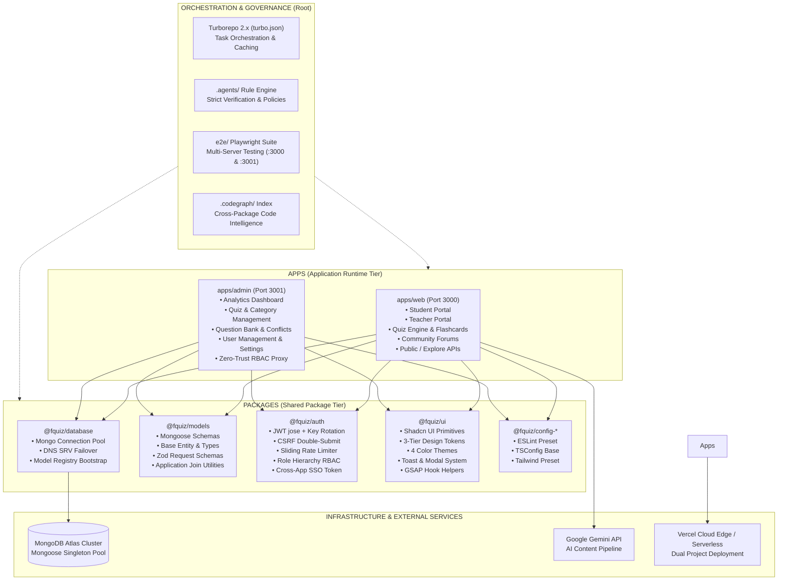
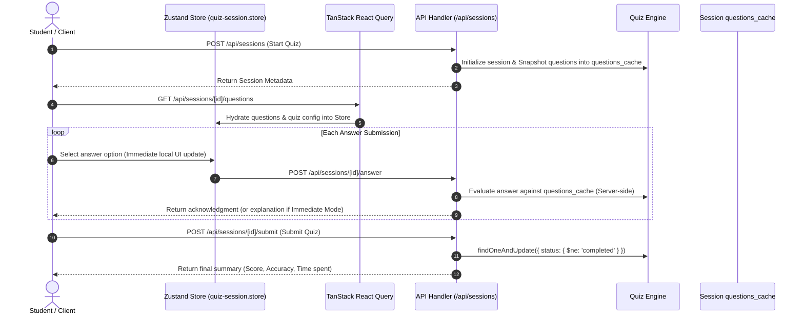

# 🏗️ FQuiz — System Architecture Documentation (`docs/ARCHITECTURE.md`)

> **Version**: 2.0.0 (Pure Symmetrical Monorepo Architecture)  
> **Status**: Master Architecture Specification  
> **Tech Stack**: Next.js 16 App Router (Turbopack), Turborepo 2.x, React 18, Tailwind CSS 3, MongoDB / Mongoose 9, TypeScript 5, Playwright, Jest, GitHub Actions CI/CD.

---

## 1. ARCHITECTURAL OVERVIEW

The **Full Monorepo (Pure Symmetrical Monorepo)** architecture of the FQuiz platform clearly isolates **3 distinct tiers** within a single unified repository:

1. **Application Runtime Tier (`apps/*`)**:
   - `apps/web`: Web application serving Students, Teachers, Guests, and Community Forums (Port 3000 / `https://example.invalid`).
   - `apps/admin`: Standalone System Admin Portal guarded by a Zero-Trust RBAC Proxy (Port 3001 / `https://example.invalid`).
2. **Shared Package Tier (`packages/*`)**:
   - `packages/database`: Singleton MongoDB Atlas connection pool, DNS SRV fallback, Model Registry bootstrap.
   - `packages/models`: Single Source of Truth for all Mongoose Schemas, Base Entity, Interfaces, and Zod validation.
   - `packages/auth`: Security & Authentication toolkit (JWT Key Rotation, Crypto, Double-Submit CSRF, Rate Limiting, Role Hierarchy, SSO).
   - `packages/ui`: Shared UI library (Shadcn primitives, CSS variable design tokens, Toast store, Theme Provider, GSAP helpers).
   - `packages/config-typescript` & `packages/config-eslint`: Shared linting, formatting, and TypeScript compiler configurations.
3. **Orchestration & Governance Tier (`.` - Root Workspace)**:
   - Orchestrates multi-package build, test, and lint pipelines via **Turborepo**, and enforces strict repository invariants via the **AI Governance Rule Engine** (`.agents/scripts/`).



---

## 2. CORE ARCHITECTURAL INVARIANTS

To maintain rigorous technical quality, runtime stability, and long-term maintainability, all systems must adhere to **8 non-negotiable invariants**:

1. **Text-Only Learning Scope Boundary**: FQuiz is strictly dedicated to text-based learning, examination, and reinforcement (vocabulary, grammar, questions, answer options, detailed explanations, reading passages, flashcards). **Never introduce audio, speech recognition (TTS/STT), OCR, 3D WebGL, VR, or heavy multimedia processing into the codebase**.
2. **No Direct Cross-Module or Cross-App Model Imports**:
   - `apps/web` and `apps/admin` MUST NEVER import code or models directly from each other.
   - Business modules (`auth`, `quiz`, `classroom`, `community`, `ai`) may only import internal models or access domain entities via `@fquiz/models`.
3. **Mongoose `.populate()` is Forbidden**: All inter-collection relationships must be resolved at the application level (**Application-Level Join**) using batch `$in` queries. This completely eliminates query bloat, lock contention, and tight coupling across collections.
4. **Server-Authoritative Quiz Engine with Race Condition Prevention**: Exam session state, remaining duration, answer evaluation, and score calculation are computed exclusively by the server against `session.questions_cache`. All session status mutations must utilize atomic `findOneAndUpdate` queries conditioned on `{ status: { $ne: 'completed' } }` to eliminate double submissions and race conditions.
5. **AI Content Deduplication & Cache Layer**: Before calling the Google Gemini API, the system computes a SHA-256 hash of the request payload (`requestHash`) and checks the `AIAsset` collection. If a matching cached entry exists, it is returned immediately without consuming API quota.
6. **Single Source of Truth for Schemas & Data Types**: All Mongoose Schemas, Base Entity definitions, TypeScript Interfaces, and Zod Validation Schemas are centralized exclusively in `@fquiz/models`. Both Web and Admin consume the same schema definitions to eradicate Schema Drift, enforce security safeguards (`select: false` on `password_hash`), and synchronize validation constraints (username max length 30, questions max 10,000 characters).
7. **Zero-Trust Security & Multi-Tier Authorization**:
   - JWT tokens are signed and verified using `jose` with **Zero-Downtime Key Rotation** (`JWT_SECRET` + `JWT_SECRET_PREV`).
   - Every mutation API endpoint requires a Double-Submit CSRF token (`csrf-token` cookie + `x-csrf-token` header).
   - Sensitive endpoints are shielded with a sliding window rate limiter and RBAC edge proxies.
8. **3-Tier Design Tokens & GPU-Accelerated Animations**:
   - The UI conforms to a 3-tier token hierarchy (Global Base Tokens → Semantic Design Tokens → Component Scoped Tokens) across 4 standard themes (Light, Dark, Slate-Green, Slate-Pink), achieving full **WCAG 2.2 AA** contrast compliance.
   - Micro-interaction animations leverage `@gsap/react` via `useGSAP()`, targeting only GPU transform aliases (`x`, `y`, `scale`, `rotation`, `autoAlpha`), cleaning up context on unmount, and honoring `prefers-reduced-motion`.

---

## 3. EXHAUSTIVE DIRECTORY LAYOUT

```
fquiz/
├── apps/
│   ├── web/                               # 🎓 Web Student, Teacher & Community Portal (Port 3000)
│   │   ├── app/                           # Next.js 16 App Router
│   │   │   ├── (auth)/                    # Login, Register, Forgot-Password, Restore Account
│   │   │   ├── (student)/                 # Dashboard, My Quizzes, History, Classrooms, Settings
│   │   │   ├── (teacher)/                 # Classrooms, Quizzes, Assignments, Reports
│   │   │   ├── quiz/                      # Quiz Engine (Immediate, Review, Flashcard, Mobile)
│   │   │   ├── community/                 # Academic Community Forum (Posts, Comments, Likes)
│   │   │   ├── explore/                   # Public Quiz & Category Discovery
│   │   │   └── api/                       # Web REST APIs & Next.js Server Actions
│   │   ├── components/                    # Web-specific Components (Quiz, Classroom, Community, AI)
│   │   ├── hooks/                         # Web React Hooks (useSessionAnswerSync, useSubmitAnswer)
│   │   ├── store/                         # Zustand Stores (quiz-session.store.ts)
│   │   ├── lib/                           # Web Feature Services (AIContentService, QuizEngine)
│   │   ├── proxy.ts                       # Web Edge Proxy Middleware (Redirect /admin, Security Headers)
│   │   ├── next.config.js                 # Next.js 16 Web Config (Transpile packages, CSP, Turbopack)
│   │   ├── tailwind.config.ts             # Tailwind CSS (inherits @fquiz/ui preset)
│   │   ├── tsconfig.json                  # TSConfig (inherits @fquiz/config-typescript)
│   │   ├── vercel.json                    # Vercel Web Cron & Header Config
│   │   └── package.json                   # name: "@fquiz/web"
│   │
│   └── admin/                             # 🛡️ Standalone Admin Portal (Port 3001)
│       ├── app/                           # Next.js 16 App Router (Slim Orchestrators <90 lines)
│       │   ├── (dashboard)/               # Categories, Feedback, Question Bank, Quizzes, Settings, Users
│       │   ├── login/                     # Dedicated Admin Login Route
│       │   └── api/                       # Admin REST APIs (CRUD Quizzes, Users, Migrations, Status)
│       ├── components/                    # Admin UI Components (Panels, Tables, Conflict Resolvers)
│       ├── hooks/                         # Admin Hooks (useAdminQuizzes, useQuestionBankAnalytics)
│       ├── proxy.ts                       # Zero-Trust Admin Proxy Middleware (RBAC Guard)
│       ├── next.config.js                 # Next.js 16 Admin Config
│       ├── tailwind.config.ts             # Tailwind CSS (inherits @fquiz/ui preset)
│       ├── tsconfig.json                  # TSConfig
│       ├── vercel.json                    # Vercel Region Config (sin1)
│       └── package.json                   # name: "@fquiz/admin"
│
├── packages/
│   ├── database/                          # 🗄️ Database Singleton & Connection Management
│   │   ├── src/
│   │   │   ├── mongodb.ts                 # Mongoose Singleton Connection with DNS SRV Failover
│   │   │   ├── model-registry.ts          # Lazy Model Bootstrap preventing MissingSchemaError
│   │   │   ├── base-schema.ts             # Base schema plugin (timestamps, soft delete, status)
│   │   │   └── index.ts                   # Database utilities export entry point
│   │   ├── tsconfig.json
│   │   └── package.json                   # name: "@fquiz/database"
│   │
│   ├── models/                            # 📦 Single Source of Truth for Data Models
│   │   ├── src/
│   │   │   ├── entities/                  # Base Entity, Interfaces, Enums
│   │   │   │   ├── base-entity.ts         # IBaseEntity interface
│   │   │   │   └── index.ts
│   │   │   ├── models/                    # Mongoose Models
│   │   │   │   ├── user.model.ts          # User Model & Roles
│   │   │   │   ├── quiz.model.ts          # Quiz & Question Embedded Models
│   │   │   │   ├── quiz-session.model.ts  # QuizSession Model (Server-side tracking)
│   │   │   │   ├── question-bank.model.ts # QuestionBank Model (SHA-256 deduplication)
│   │   │   │   ├── category.model.ts      # Category Model
│   │   │   │   ├── feedback.model.ts      # Feedback Model
│   │   │   │   ├── classroom.model.ts     # Classroom & Assignment Models
│   │   │   │   ├── community.model.ts     # Post & Comment Models
│   │   │   │   ├── ai-asset.model.ts      # AIAsset Model (Prompt Deduplication)
│   │   │   │   └── site-settings.model.ts # SiteSettings Model (System Config)
│   │   │   ├── schemas/                   # Zod Request Schemas & DTO Validation
│   │   │   ├── utils/                     # SHA-256 Fingerprinting & Join Helpers
│   │   │   │   ├── question-fingerprint.ts# generateQuestionId & generateQuestionFingerprint
│   │   │   │   └── join-helper.ts         # Batch $in application-level join utility
│   │   │   └── index.ts                   # Export entry point for models, schemas & utils
│   │   ├── tsconfig.json
│   │   └── package.json                   # name: "@fquiz/models"
│   │
│   ├── auth/                              # 🔐 Security, JWT & Auth Infrastructure
│   │   ├── src/
│   │   │   ├── jwt.ts                     # JWT Verify & Sign with Zero-Downtime Rotation (jose)
│   │   │   ├── csrf.ts                    # Double-Submit CSRF Validation & Token Generator
│   │   │   ├── crypto.ts                  # Password Hashing (bcryptjs) & Secure Token Generation
│   │   │   ├── rate-limit.ts              # Sliding Window Memory Rate Limiter
│   │   │   ├── rbac.ts                    # Role Hierarchy, Permissions & Auth Guards
│   │   │   ├── with-auth.ts               # Higher-Order Function for API Route Handlers
│   │   │   └── index.ts                   # Export entry point for auth utilities
│   │   ├── tsconfig.json
│   │   └── package.json                   # name: "@fquiz/auth"
│   │
│   ├── ui/                                # 🎨 Shared UI Primitives & Design System
│   │   ├── src/
│   │   │   ├── components/                # Radix UI + Tailwind Primitives (Button, Card, Dialog...)
│   │   │   ├── theme/                     # 3-Tier Design Tokens, ThemeProvider, WCAG Contrast Checkers
│   │   │   ├── toast/                     # Zustand Toast Store & UI Toaster Component
│   │   │   ├── lib/                       # Utility functions (cn, animations)
│   │   │   ├── tailwind-preset.ts         # Shared Tailwind Config Preset
│   │   │   └── index.ts                   # Export entry point for UI components & tokens
│   │   ├── tsconfig.json
│   │   └── package.json                   # name: "@fquiz/ui"
│   │
│   └── config-typescript/                 # ⚙️ Shared TypeScript Configs
│       ├── base.json                      # Base TypeScript configuration
│       ├── nextjs.json                    # Optimized TypeScript configuration for Next.js 16
│       ├── react-library.json             # TypeScript configuration for React Component Libraries
│       └── package.json                   # name: "@fquiz/config-typescript"
│
├── e2e/                                   # 🧪 Multi-Server End-to-End Test Suite (Playwright)
├── .agents/                               # 🤖 AI Agent Governance & CI/CD Verification Engine
├── turbo.json                             # ⚡ Turborepo Task Pipeline & Cache Orchestration
└── package.json                           # 📦 Monorepo Root Package
```

---

## 4. PACKAGE BOUNDARY MATRIX

### 4.1. Permitted Imports Across Packages & Apps

| Source Package / App | Permitted Imports | Strictly FORBIDDEN Imports |
|---|---|---|
| `apps/web` | `@fquiz/database`, `@fquiz/models`, `@fquiz/auth`, `@fquiz/ui`, `@fquiz/config-*` | `apps/admin` |
| `apps/admin` | `@fquiz/database`, `@fquiz/models`, `@fquiz/auth`, `@fquiz/ui`, `@fquiz/config-*` | `apps/web` |
| `@fquiz/database` | `mongoose` | `apps/*`, `@fquiz/models`, `@fquiz/auth`, `@fquiz/ui` |
| `@fquiz/models` | `@fquiz/database`, `mongoose`, `zod` | `apps/*`, `@fquiz/auth`, `@fquiz/ui` |
| `@fquiz/auth` | `@fquiz/models`, `jose`, `bcryptjs` | `apps/*`, `@fquiz/ui` |
| `@fquiz/ui` | `react`, `lucide-react`, `@radix-ui/*`, `@gsap/react`, `zustand` | `apps/*`, `@fquiz/database`, `@fquiz/models`, `@fquiz/auth` |

### 4.2. Application-Level Join Pattern (Replacing `.populate()`)

```typescript
// ✅ STANDARD: Batch Application-Level Join via $in
import { Post, User } from '@fquiz/models'

export async function getPostsWithAuthors(limit = 20) {
  const posts = await Post.find().sort({ createdAt: -1 }).limit(limit).lean()
  if (posts.length === 0) return []

  const authorIds = [...new Set(posts.map((p) => p.authorId.toString()))]
  const users = await User.find({ _id: { $in: authorIds } })
    .select('_id name avatar role')
    .lean()

  const userMap = new Map(users.map((u) => [u._id.toString(), u]))

  return posts.map((post) => ({
    ...post,
    author: userMap.get(post.authorId.toString()) || {
      _id: post.authorId,
      name: 'Anonymous User',
      role: 'student',
    },
  }))
}
```

---

## 5. DATA FLOW & STATE MANAGEMENT



- **Server State (TanStack Query v5)**: Orchestrates data fetching, query deduplication, caching, and background revalidation for all REST API endpoints.
- **Client State (Zustand v5)**: Manages 0ms-latency UI interactions (`quiz-session.store.ts` for offline/localStorage exam state sync, `toast-store.ts` for global notification banners).

---

## 6. AI ENGINE & DEDUPLICATION PIPELINE

### 6.1. AI Content Pipeline with SHA-256 Deduplication
- Integrates Google Gemini API (or OpenAI/Custom endpoints) to generate questions, flashcards, vocabulary, grammar, and explanations.
- 2-Tier Caching via the `AIAsset` collection:
  1. Hash the prompt payload with `SHA-256` (`requestHash`).
  2. Query `AIAsset.findOne({ requestHash, aiProvider })`. If a valid record exists, return cached data immediately (0 API quota consumption).
  3. If missing, call the Gemini API, validate structured output against a **Zod Schema**, persist into `AIAsset`, and return to the client.

### 6.2. Quiz AI Assistant (Real-Time Exam Assistant)
- **Intent Resolver**: Classifies student requests (concept explanation, mistake analysis, similar question lookup).
- **Context Resolver**: Packages current question content, selected choices, and correct answers as bounded context.
- **Question Retriever**: Retrieves related questions from the Question Bank for illustrative clarity.
- **Confidence Engine**: Evaluates response confidence and safety prior to responding.

---

## 7. SECURITY, AUTHENTICATION & SINGLE SIGN-ON (SSO)

- **Zero-Downtime Key Rotation**: Signs and verifies JWTs using `jose` with dual keys: `JWT_SECRET` (active) and `JWT_SECRET_PREV` (previous). Secret rotations never invalidate existing active sessions.
- **Double-Submit CSRF**: All API mutation methods (`POST`, `PUT`, `DELETE`, `PATCH`) require an `x-csrf-token` header matching the `csrf-token` cookie.
- **Sliding Window Rate Limiter**: Throttles public and sensitive endpoints (Login, Register, AI Generation) based on IP address and User ID.
- **Cross-App SSO & Edge Proxies**:
  - `apps/web/proxy.ts`: Redirects `/admin` routes to `NEXT_PUBLIC_ADMIN_URL` (`example.invalid`) and isolates `/api/admin` with HTTP 404.
  - `apps/admin/proxy.ts`: Zero-Trust RBAC Proxy enforcing `role === 'admin'`. Non-admin tokens are rejected with HTTP `403 Forbidden`.

---

## 8. DESIGN SYSTEM: 3-TIER TOKENS & GSAP ANIMATIONS

- **3-Tier Design Tokens Architecture**:
  1. **Global Base Tokens**: Define raw HSL color values.
  2. **Semantic Design Tokens**: Map semantic CSS variables (`--background`, `--foreground`, `--primary`, `--card`, `--border`...).
  3. **Component Scoped Tokens**: Consumed directly within components via Tailwind utility classes.
- **4 Standard Themes**: `Light`, `Dark`, `Slate-Green`, and `Slate-Pink` complying with **WCAG 2.2 AA (>= 4.5:1)** contrast.
- **GSAP UI/UX Animation Standards**:
  - Integrated via `@gsap/react` using `useGSAP({ scope: containerRef })`.
  - Animates GPU transform aliases only (`x`, `y`, `scale`, `rotation`, `autoAlpha`).
  - Supports `prefers-reduced-motion` using `gsap.matchMedia()`.

---

## 9. MONOREPO ORCHESTRATION & VERCEL OPERATIONS

- **Turborepo Task Pipeline (`turbo.json`)**:
  - `build`: Concurrently builds `apps/web` and `apps/admin`, caching build outputs.
  - `check-types`: Validates TypeScript across all 7 workspaces (`apps/*` & `packages/*`).
  - `lint`: Runs ESLint across the entire monorepo.
- **Dual Vercel Deployment**:
  - **Project 1 (Web)**: Root Directory = `apps/web`, Output Directory = `.next`, Domain = `example.invalid`.
  - **Project 2 (Admin)**: Root Directory = `apps/admin`, Output Directory = `.next`, Domain = `example.invalid`.
- **Database Connection Pooling**: Mongoose Singleton Pool featuring automatic DNS fallback (`8.8.8.8, 1.1.1.1`) against SRV lookup failures.

---

## 10. TESTING STRATEGY & AI GOVERNANCE ENGINE

- **Playwright Multi-Server E2E (`e2e/`)**: 16 end-to-end test scenarios coordinating both Web (`:3000`) and Admin (`:3001`) servers concurrently.
- **Jest Unit & Integration (`npm test`)**: 66 test suites with 430 test cases covering Quiz Engine, AI Assistant, Auth, CSRF, and Cache layers.
- **AI Agent Governance Engine (`node .agents/scripts/verify.js --strict`)**: 18 automated rules executed in GitHub Actions CI/CD to guarantee 100% adherence to TypeScript compiler checks, ESLint, module boundaries, secret prevention, and WCAG 2.2 AA theme governance.
