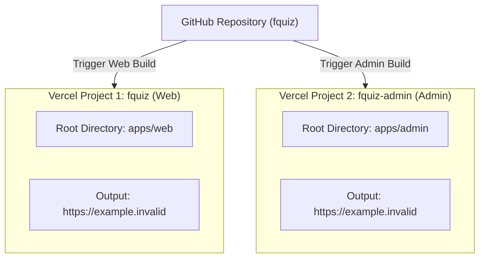
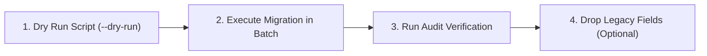

# 🚀 FQuiz — Monorepo Deployment & Operations Guide (`docs/DEPLOYMENT.md`)

This document provides a comprehensive operational guide for deploying, configuring infrastructure across **Vercel** (Turborepo Monorepo with two independent Vercel Projects) and **MongoDB Atlas**, establishing environment variables, database management, performance optimization, and zero-downtime data migration workflows for the **FQuiz** platform.

---

## 1. Monorepo Structure & Workspaces

FQuiz is organized as a **Pure Symmetrical Turborepo Monorepo** comprising 2 runtime applications and 5 shared packages:

```
fquiz/
├── apps/
│   ├── web/                            # 🎓 Web Student, Teacher & Community Portal (Port 3000 / example.invalid)
│   │   ├── app/                        # Next.js 16 App Router ((auth), (student), (teacher), quiz, community, explore, api)
│   │   ├── components/                 # Web UI Components (Quiz, Classroom, Community, AI Assistant)
│   │   ├── hooks/                      # Web Custom React Hooks
│   │   ├── store/                      # Zustand State Stores (quiz-session, toast)
│   │   ├── lib/                        # Web Services & Feature Modules (AIContentService, QuizEngine)
│   │   ├── proxy.ts                    # Web Edge Proxy Middleware (Redirect /admin, Security Headers)
│   │   ├── next.config.js              # Next.js 16 Web Config (Transpile packages, Turbopack)
│   │   ├── tailwind.config.ts          # Tailwind CSS (inherits @fquiz/ui preset)
│   │   ├── vercel.json                 # Vercel Web Cron & sin1 Region Config
│   │   └── package.json                # name: "@fquiz/web"
│   │
│   └── admin/                          # 🛡️ Standalone Admin Portal (Port 3001 / example.invalid)
│       ├── app/                        # Next.js 16 App Router (Slim Orchestrator Pages <90 lines)
│       │   ├── (dashboard)/            # Categories, Feedback, Question-bank, Quizzes, Settings, Users
│       │   ├── login/                  # Dedicated Admin Login Route
│       │   └── api/                    # Admin REST APIs (Quizzes, Users, Question Bank, Settings)
│       ├── components/                 # Admin UI Components & Subcomponents (Isolated layers)
│       ├── hooks/                      # Custom Hooks Layer (State, API Mutations & Business Logic)
│       ├── proxy.ts                    # Zero-Trust Admin Proxy Middleware (Node.js runtime)
│       ├── next.config.js              # Next.js 16 Admin Config
│       ├── tailwind.config.ts          # Tailwind CSS (inherits @fquiz/ui preset)
│       ├── vercel.json                 # Vercel Admin Region Config (sin1)
│       └── package.json                # name: "@fquiz/admin"
│
├── packages/
│   ├── database/                       # 🗄️ Database Singleton & Connection Pool (@fquiz/database)
│   ├── models/                         # 📦 Single Source of Truth Mongoose Schemas & Types (@fquiz/models)
│   ├── auth/                           # 🔐 Security, JWT Rotation, CSRF & RBAC (@fquiz/auth)
│   ├── ui/                             # 🎨 Shared UI Primitives, 3-Tier Tokens & GSAP (@fquiz/ui)
│   └── config-typescript/              # ⚙️ Shared TypeScript Configs (@fquiz/config-typescript)
│
├── e2e/                                # 🧪 Playwright E2E Multi-Server Test Suite (57 Tests)
├── .agents/                            # 🤖 AI Agent Governance & CI/CD Verification Engine
├── turbo.json                          # ⚡ Turborepo Task Pipeline & Remote Caching
└── package.json                        # 📦 Monorepo Root Package
```

---

## 2. Setting Up 2 Independent Vercel Projects

The system deploys **2 distinct Vercel Projects** connected to the same GitHub repository:



### 2.1. Project 1: `fquiz` (Student & Teacher Web Portal)

* **Vercel Dashboard Settings**:
  * **Project Name**: `fquiz` (or `fquiz-web`)
  * **Framework Preset**: `Next.js`
  * **Root Directory**: `apps/web`
  * **Include source files outside of the Root Directory in the Build Step**: **ENABLED (Checked)** *(Mandatory for Vercel to discover root `node_modules` and shared workspaces)*.
  * **Build Command**: `npm run build`
  * **Output Directory**: `.next`
  * **Install Command**: `npm install`
  * **Ignored Build Step** (*Project Settings* → *Git*):
    ```bash
    npx turbo-ignore
    ```

* **Manual Deployment via Vercel CLI**:
  ```bash
  cd apps/web
  npx vercel link --project fquiz --yes --scope nvtruongops
  npx vercel --prod --yes
  ```

---

### 2.2. Project 2: `fquiz-admin` (System Admin Portal)

* **Vercel Dashboard Settings**:
  * **Project Name**: `fquiz-admin`
  * **Framework Preset**: `Next.js`
  * **Root Directory**: `apps/admin`
  * **Include source files outside of the Root Directory in the Build Step**: **ENABLED (Checked)** *(Mandatory for Vercel to discover root `node_modules` and shared workspaces)*.
  * **Build Command**: `npm run build`
  * **Output Directory**: `.next`
  * **Install Command**: `npm install`
  * **Ignored Build Step** (*Project Settings* → *Git*):
    ```bash
    npx turbo-ignore
    ```

* **Manual Deployment via Vercel CLI**:
  ```bash
  cd apps/admin
  npx vercel link --project fquiz-admin --yes --scope nvtruongops
  npx vercel --prod --yes
  ```

---

## 3. Vercel Environment Variables Configuration

Both Vercel projects must be configured with the following environment variables in **Project Settings** → **Environment Variables**:

### 3.1. Core Mandatory Variables

| Variable | Web (`fquiz`) | Admin (`fquiz-admin`) | Description & Notes |
|---|:---:|:---:|---|
| `MONGODB_URI` | ✅ | ✅ | Shared MongoDB Atlas connection string (e.g., `mongodb+srv://...`). |
| `JWT_SECRET` | ✅ | ✅ | **MUST BE 100% IDENTICAL** (minimum 32 chars / 64 hex) to enable session sharing and cross-app authentication. |
| `JWT_SECRET_PREV` | ✅ | ✅ | Prior secret key used during Zero-Downtime Key Rotation. |
| `APP_URL` | `https://example.invalid` | `https://example.invalid` | Canonical production URL for each respective app. |
| `CORS_ALLOWED_ORIGINS` | `https://example.invalid,https://example.invalid` | `https://example.invalid,https://example.invalid` | Comma-separated domains authorized for cross-origin API calls in `proxy.ts`. |
| `NEXT_PUBLIC_ADMIN_URL` | `https://example.invalid/login` | — | Navigation target for administrative redirections from Web `/login`. |

### 3.2. Security, Cron Jobs & AI Providers

| Variable | Web (`fquiz`) | Admin (`fquiz-admin`) | Description & Notes |
|---|:---:|:---:|---|
| `CRON_SECRET` | ✅ | — | Secret key authenticating Vercel Cron cleanup tasks (`/api/jobs/cleanup-deleted-accounts`). |
| `ENCRYPTION_KEY` | ✅ | ✅ | 32-byte hex string for AES-256-GCM encryption of database-persisted LLM API keys. |
| `GEMINI_API_KEY` | ✅ | ✅ | Default Google Gemini AI API key for Question Bank and AI Quiz Assistant. |
| `OPENAI_API_KEY` | ✅ | ✅ | (Optional) OpenAI API Key or custom provider integration. |
| `OPENAI_BASE_URL` | ✅ | ✅ | (Optional) Base URL for OpenAI-compatible inference endpoints. |
| `OPENAI_MODEL` | ✅ | ✅ | (Optional) Target AI model identifier. |
| `LOG_LEVEL` | `info` | `info` | Pino Logger log severity level (`info` in production, `debug` in development). |

### 3.3. Email Services & OAuth (Web Portal)

| Variable | Web (`fquiz`) | Admin (`fquiz-admin`) | Description & Notes |
|---|:---:|:---:|---|
| `MAIL_HOST` / `MAIL_PORT` | ✅ | — | SMTP mail server hostname and port (e.g., `smtp.gmail.com`, port `587`). |
| `MAIL_USER` / `MAIL_APP_PASSWORD` | ✅ | — | Credentials for dispatching OTP verification and password reset emails. |
| `MAIL_FROM` | ✅ | — | Formatted sender identity (e.g., `"FQuiz Support <no-reply@fquiz.com>"`). |
| `NEXT_PUBLIC_GOOGLE_CLIENT_ID` | ✅ | — | Google OAuth Client ID for Google Single Sign-On. |
| `GOOGLE_CLIENT_SECRET` | ✅ | — | Google OAuth Client Secret. |
| `ALLOWED_IMAGE_DOMAINS` | ✅ | — | Comma-delimited list of external hostnames permitted for Next.js Image optimization. |

---

## 4. Vercel Infrastructure & Performance Optimization

1. **Vercel Serverless Regions (`sin1`)**:
   - Both `apps/web/vercel.json` and `apps/admin/vercel.json` are pinned to the **`sin1` (Singapore)** region to achieve sub-40ms latency for Southeast Asian clients and MongoDB Atlas clusters.

2. **Code Splitting & Dynamic Imports Optimization**:
   - `next/dynamic` with `ssr: false` is applied across heavyweight administrative tools in `apps/admin/app/(dashboard)/question-bank/page.tsx`.
   - Reduces initial JavaScript bundle sizes and defers loading advanced features until triggered by user interaction.

3. **Vercel Cron Jobs (Automated Data Hygiene)**:
   - `apps/web/vercel.json` schedules a daily cron job at 02:00 UTC:
     ```json
     "crons": [
       {
         "path": "/api/jobs/cleanup-deleted-accounts",
         "schedule": "0 2 * * *"
       }
     ]
     ```
   - The `/api/jobs/cleanup-deleted-accounts` handler validates the `Authorization: Bearer <CRON_SECRET>` header and purges soft-deleted records past the 72-hour grace period (GDPR compliance).

4. **Anti-Enumeration Safeguards & Zero-Trust Architecture**:
   - Web Login (`/login`) returns neutral error responses on authentication failures.
   - Successful admin logins on Web automatically redirect to `NEXT_PUBLIC_ADMIN_URL` (`https://example.invalid/login`).
   - The Admin Proxy (`apps/admin/proxy.ts`) operates under Zero-Trust rules, rejecting non-admin requests prior to server component evaluation.

5. **Security Headers (CSP, HSTS & Permissions Policy)**:
   - Configured in `apps/web/next.config.js` and `apps/admin/next.config.js`: Content Security Policy (CSP), `X-Frame-Options: DENY`, `X-Content-Type-Options: nosniff`, `Strict-Transport-Security` (HSTS), and `Permissions-Policy`.

---

## 5. Database Management & Zero-Downtime Migrations

To upgrade database schemas without interrupting active examinees, FQuiz uses a **Backward-Compatible Migration** pattern:



### Safe Migration Workflow:

1. **Execute Dry-Run** to verify affected record volume without altering live data:
   ```bash
   npm run migrate:preserve-results:dry-run
   ```
2. **Execute Live Migration**:
   ```bash
   npm run migrate:preserve-results
   ```
3. **Verify Data Integrity** post-migration:
   ```bash
   npm run audit:quiz-codes
   npm run audit:answer-conflicts
   ```

---

## 6. Operations & Verification Cheatsheet

| Command | Task Description |
|---|---|
| `npm run dev` | Run Web (`:3000`) and Admin (`:3001`) concurrently via Turborepo |
| `npm run dev:web` | Run Web portal independently (`http://localhost:3000`) |
| `npm run dev:admin` | Run Admin Portal independently (`http://localhost:3001`) |
| `npm run build` | Production build across entire monorepo (`apps/web` + `apps/admin`) |
| `npm run build:web` | Production build for Web portal |
| `npm run build:admin` | Production build for Admin Portal |
| `npm run lint` | ESLint across entire monorepo |
| `npm run check-types` | TypeScript type-check across all 7 workspaces |
| `npm test` | Run all Jest Unit & Integration Tests (66 suites, 430 tests) |
| `npx playwright test` | Run all Playwright E2E Tests (Multi-server `:3000` & `:3001`) |
| `node .agents/scripts/verify.js --strict` | Run AI Agent Governance Rule Engine (18 strict checks) |

---

## 7. Pre-Deployment & Post-Deployment Checklist

### 📋 Pre-Deployment
- [x] Run `npm run lint` (0 ESLint errors).
- [x] Run `npm run check-types` (0 TypeScript errors across 7 workspaces).
- [x] Run `npm run build` (Successful compilation of both Web and Admin).
- [x] Run `npm test` (66/66 suites, 430/430 tests pass).
- [x] Run `npx playwright test` (57/57 E2E tests pass).
- [x] Run `node .agents/scripts/verify.js --strict` (18/18 rule checks pass).
- [x] Environment variables verified across both Vercel Projects (`MONGODB_URI`, identical `JWT_SECRET`, `CRON_SECRET`, `CORS_ALLOWED_ORIGINS`).

### 📋 Post-Deployment
- [x] Visit `https://example.invalid` and `https://example.invalid` to verify HTTPS & HTTP 200 OK.
- [x] Sign in with Administrator credentials on `fquiz-web` → Confirm redirection to `fquiz-admin`.
- [x] Sign in directly on `fquiz-admin` → Confirm dashboard, quizzes, users, categories, and question bank views.
- [x] In *Vercel Dashboard* → *Cron Jobs*, confirm `/api/jobs/cleanup-deleted-accounts` is active.
