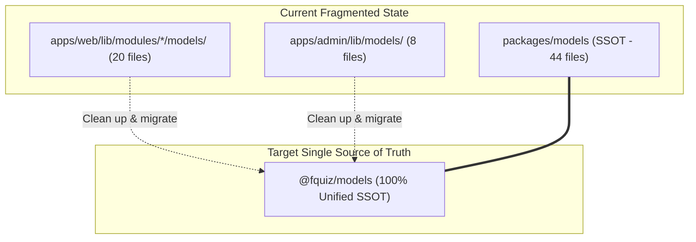
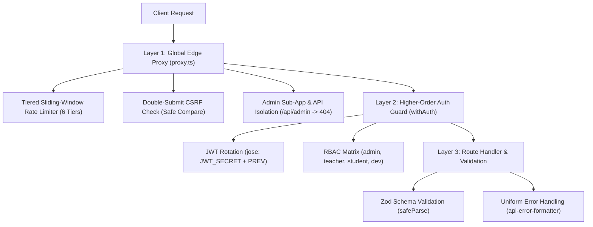
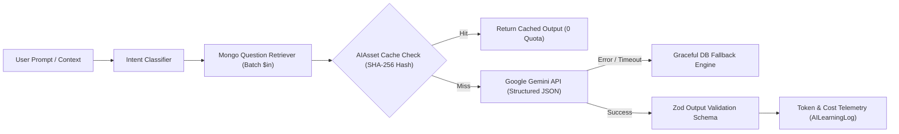
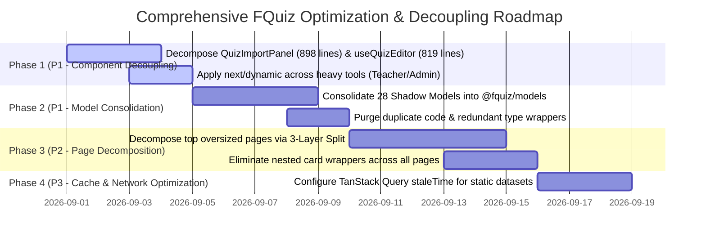

# 📊 Comprehensive Repository Audit Report: FQuiz (Strict Full-Repository Audit Report)

> **Version**: 2.2.0  
> **Audit Date**: 2026-08-29  
> **Audit Scope**: Complete codebase of **871 files** across 7 packages/apps (`apps/web`, `apps/admin`, `packages/models`, `packages/database`, `packages/auth`, `packages/ui`, `packages/config-typescript`), **103 REST API Route Handlers**, **55 AI subsystem files**, **69 Jest Test Suites (450 tests)**, **57 Playwright E2E Tests**, and **18 AI Rule Engine verification rules**.  
> **Document Structure**: Organized across 10 specialized sections providing a 360-degree review of architecture, source hygiene, security, query efficiency, and UX ergonomics.

---

## 📑 TABLE OF CONTENTS

1. [Section 1: Overview & Systemic Health Scorecard](#section-1-overview--systemic-health-scorecard)
2. [Section 2: Anti-Complexity & Over-Engineering Audit (Ponytail Audit)](#section-2-anti-complexity--over-engineering-audit-ponytail-audit)
3. [Section 3: Complexity Hotspots: Fat Components, Hooks & Pages (>200 Lines)](#section-3-complexity-hotspots-fat-components-hooks--pages)
4. [Section 4: Data Model Audit & Map of 28 Shadow Models](#section-4-data-model-audit--map-of-28-shadow-models)
5. [Section 5: REST API Layer, Middleware & 3-Tier Zero-Trust Security (103 Routes)](#section-5-rest-api-layer-middleware--3-tier-zero-trust-security)
6. [Section 6: State Management, TanStack Query Caching & Network Audit](#section-6-state-management-tanstack-query-caching--network-audit)
7. [Section 7: AI Subsystem & Quiz AI Assistant Audit (55 Files)](#section-7-ai-subsystem--quiz-ai-assistant-audit-55-files)
8. [Section 8: User Interface, Accessibility (a11y) & GSAP Animation Performance](#section-8-user-interface-accessibility-a11y--gsap-animation-performance)
9. [Section 9: Testing Strategy, CI/CD Governance & Monorepo Dependencies](#section-9-testing-strategy-cicd-governance--monorepo-dependencies)
10. [Section 10: Consolidated Issue Matrix & 4-Stage Optimization Roadmap](#section-10-consolidated-issue-matrix--4-stage-optimization-roadmap)

---

## SECTION 1: OVERVIEW & SYSTEMIC HEALTH SCORECARD

```mermaid
radar
    title Technical Health Across 6 Core Pillars (Scale 0-10)
    "Monorepo Architecture" : 8.5
    "Code Leanliness" : 6.5
    "Single Source Models" : 7.0
    "Database & DAL" : 9.0
    "Security & API Guards" : 9.5
    "UI/UX Theme & Accessibility" : 9.0
```

### Comprehensive Scorecard

| Assessment Pillar | Score | Technical Status & Summary |
|---|:---:|---|
| **1. Monorepo Architecture & Isolation** | **8.5 / 10** | Pure Symmetrical Monorepo using Turborepo functioning cleanly. Student Web (`:3000`) and Admin Portal (`:3001`) are independent; `/api/admin` is strictly isolated on Web. |
| **2. Code Leanliness & File Weight** | **6.5 / 10** | **106 files exceed the >200 lines threshold**, including 25 components > 250 lines, 14 pages > 200 lines, and 12 custom hooks > 200 lines. |
| **3. Single Source of Truth (SSOT)** | **7.0 / 10** | Centralized `packages/models` established, yet **28 Shadow Model files** remain fragmented across `apps/web/lib/modules/*/models/` and `apps/admin/lib/models/`. |
| **4. Database & Query Performance** | **9.0 / 10** | 100% compliant with zero Mongoose `.populate()` usage, enforcing Application-level batch `$in` joins, TTL indexes, and pruned redundant indexes. |
| **5. Security & Invariant Enforcement** | **9.5 / 10** | Zero-downtime JWT rotation (`jose`), Double-Submit CSRF, tiered rate limiting, Server-Authoritative quiz engine, and schema-level protection on `password_hash` (`select: false`). |
| **6. User Interface & Accessibility (UI/UX & Themes)** | **9.0 / 10** | 3-Tier Design Tokens achieving **WCAG 2.2 AA** contrast across all 4 themes. GSAP animation integration respects `prefers-reduced-motion`. |
| **OVERALL REPO HEALTH SCORE** | **8.2 / 10** | **SOLID** — Sound technical foundation; immediate focus should target **decoupling Fat Files**, **consolidating Shadow Models**, and **optimizing client caching**. |

---

## SECTION 2: ANTI-COMPLEXITY & OVER-ENGINEERING AUDIT

*Applying the Lazy Senior Developer philosophy: YAGNI, prioritize standard library / platform APIs, remove redundant code:*

```
shrink: [apps/web/components/quiz/question-bank/QuizImportPanel.tsx] (898 lines). Decompose parser logic into useQuizImport and apply dynamic import.
shrink: [apps/web/hooks/useQuizEditor.ts] (819 lines). Split into useQuizFormState, useQuizQuestions, and useQuizAutoSave.
shrink: [apps/web/app/quiz/[id]/session/[sessionId]/flashcard/mobile/page.tsx] (819 lines). Decompose into useFlashcardGestures and FlashcardMobileView.
delete: 28 Shadow Model files located in apps/web/lib/modules/*/models/ and apps/admin/lib/models/. Re-route 100% of imports to @fquiz/models.
native: Ad-hoc manual query string parsing and formatting. Replace with Web Platform URLSearchParams.
yagni: Redundant re-export type wrappers in apps/admin/lib/types/. Consume types directly from @fquiz/models.
```

---

## SECTION 3: COMPLEXITY HOTSPOTS: FAT COMPONENTS, HOOKS & PAGES

### 3.1. Top 10 Oversized Components (Target Threshold: ≤250 lines)
1. **[`QuizImportPanel.tsx`](file:///d:/Code/fquiz/apps/web/components/quiz/question-bank/QuizImportPanel.tsx)** (**898 lines** — Exceeds by 259%): Combines File Dropzone, Regex Parsers, Preview Cards, and Validation Alerts into a single unit.
2. **[`MobileNav.tsx`](file:///d:/Code/fquiz/apps/web/components/layout/MobileNav.tsx)** (**672 lines** — Exceeds by 168%): Manages navigation tabs, sheet drawers, and active exam triggers.
3. **[`MixQuizTab.tsx`](file:///d:/Code/fquiz/apps/web/components/quiz/explore/MixQuizTab.tsx)** (**565 lines** — Exceeds by 126%): Handles subject filters, quiz multi-selection, and synthesis configuration.
4. **[`QuestionDisplay.tsx`](file:///d:/Code/fquiz/apps/web/components/quiz/session/QuestionDisplay.tsx)** (**547 lines** — Exceeds by 118%): Renders Markdown, KaTeX, Radio Groups, and Explanation Accordions.
5. **[`QuizAIAssistantDrawer.tsx`](file:///d:/Code/fquiz/apps/web/components/quiz/session/QuizAIAssistantDrawer.tsx)** (**545 lines** — Exceeds by 118%): Chat streaming UI, Feedback controls, and Token cost telemetry.
6. **[`CourseQuizList.tsx`](file:///d:/Code/fquiz/apps/web/components/quiz/explore/CourseQuizList.tsx)** (**484 lines**): Combines pagination, search inputs, filter chips, and card grid rendering.
7. **[`RecentActivitiesFeed.tsx`](file:///d:/Code/fquiz/apps/web/components/dashboard/RecentActivitiesFeed.tsx)** (**480 lines**): Multi-event feed items, date formatting, and action handlers.
8. **[`Sidebar.tsx`](file:///d:/Code/fquiz/apps/web/components/layout/Sidebar.tsx)** (**479 lines**): Collapsible navigation, profile dropdown, quick actions.
9. **[`QuizPracticeOptionsModal.tsx`](file:///d:/Code/fquiz/apps/web/components/quiz/detail/QuizPracticeOptionsModal.tsx)** (**432 lines**): Modal configuring duration, question counts, and option shuffling.
10. **[`InteractiveResultViewer.tsx`](file:///d:/Code/fquiz/apps/web/components/quiz/detail/InteractiveResultViewer.tsx)** (**418 lines**): Score charts, incorrect question listing, and answer filtering.

### 3.2. Top 10 Oversized Pages (Orchestrator Threshold: ≤200 lines)
1. **`apps/web/app/quiz/[id]/session/[sessionId]/flashcard/mobile/page.tsx`** (**819 lines**)
2. **`apps/web/app/(teacher)/teacher/classrooms/[id]/page.tsx`** (**690 lines**)
3. **`apps/web/app/quiz/[id]/page.tsx`** (**525 lines**)
4. **`apps/web/app/quiz/[id]/session/[sessionId]/flashcard/page.tsx`** (**413 lines**)
5. **`apps/web/app/(auth)/register/page.tsx`** (**403 lines**)
6. **`apps/web/app/(auth)/forgot-password/page.tsx`** (**383 lines**)
7. **`apps/web/app/(student)/student/classrooms/page.tsx`** (**349 lines**)
8. **`apps/web/app/quiz/[id]/session/[sessionId]/page.tsx`** (**349 lines**)
9. **`apps/web/app/(teacher)/teacher/classrooms/page.tsx`** (**338 lines**)
10. **`apps/web/app/(student)/profile/page.tsx`** (**327 lines**)

### 3.3. Top 10 Oversized Custom Hooks (Target Threshold: ≤200 lines)
1. **[`useQuizEditor.ts`](file:///d:/Code/fquiz/apps/web/hooks/useQuizEditor.ts)** (**819 lines** — Monolithic hook managing 15 separate states).
2. **[`useQuizFileUpload.ts`](file:///d:/Code/fquiz/apps/admin/hooks/quiz/useQuizFileUpload.ts)** (**409 lines** in Admin).
3. **[`useQuizEditorForm.ts`](file:///d:/Code/fquiz/apps/admin/hooks/quiz/useQuizEditorForm.ts)** (**383 lines** in Admin).
4. **[`useCommunityFeed.ts`](file:///d:/Code/fquiz/apps/web/hooks/useCommunityFeed.ts)** (**374 lines**).
5. **[`useMobileQuizSessionController.ts`](file:///d:/Code/fquiz/apps/web/hooks/quiz/useMobileQuizSessionController.ts)** (**316 lines**).
6. **[`useSessionActivityTracking.ts`](file:///d:/Code/fquiz/apps/web/hooks/quiz/useSessionActivityTracking.ts)** (**301 lines**).
7. **[`useMixQuizGenerator.ts`](file:///d:/Code/fquiz/apps/web/hooks/useMixQuizGenerator.ts)** (**288 lines**).
8. **[`useFlashcardSession.ts`](file:///d:/Code/fquiz/apps/web/hooks/quiz/useFlashcardSession.ts)** (**270 lines**).
9. **[`useTeacherQuizzes.ts`](file:///d:/Code/fquiz/apps/web/hooks/useTeacherQuizzes.ts)** (**256 lines**).
10. **[`useUserSettings.ts`](file:///d:/Code/fquiz/apps/web/hooks/useUserSettings.ts)** (**215 lines**).

---

## SECTION 4: DATA MODEL AUDIT & MAP OF 28 SHADOW MODELS



### 28 Shadow Model Files Scheduled for Consolidation:
- **`apps/admin/lib/models/`** (8 files): `Category.ts`, `Feedback.ts`, `LoginLog.ts`, `QuestionBank.ts`, `Quiz.ts`, `QuizSession.ts`, `SiteSettings.ts`, `User.ts`.
- **`apps/web/lib/modules/*/models/`** (20 files):
  - `ai/`: `AIAsset.ts`, `AILearningLog.ts`
  - `auth/`: `EmailVerification.ts`, `Feedback.ts`, `LoginLog.ts`, `SiteSettings.ts`, `User.ts`
  - `classroom/`: `Classroom.ts`, `ClassroomMember.ts`, `QuizAssignment.ts`, `QuizAssignmentProgress.ts`
  - `community/`: `Post.ts`
  - `quiz/`: `Category.ts`, `MigrationLog.ts`, `PinnedQuestion.ts`, `Question.ts`, `QuestionBank.ts`, `Quiz.ts`, `QuizComment.ts`, `QuizSession.ts`

---

## SECTION 5: REST API LAYER, MIDDLEWARE & 3-TIER ZERO-TRUST SECURITY



### 5.1. Distribution of 103 REST API Route Handlers by Module

| Workspace | Module | Route Count | Primary Capability & Security Characteristics |
|---|---|:---:|---|
| **`apps/web`** | `student` | **22** | Student dashboard, pinned questions, favorite categories, assignment progress |
| | `sessions` | **14** | Exam session creation, atomic submissions, heartbeat activity, flashcard reviews |
| | `auth` | **9** | Login, OTP registration, password reset, account restoration, Google OAuth |
| | `v1` | **8** | Quiz AI Assistant, semantic question discovery, automated explanations |
| | `question-bank` | **7** | Subject question banks, conflict resolution, deduplication checks |
| | `community` | **6** | Academic discussions, comments, likes, social engagement |
| | `teacher` | **5** | Classroom administration, assignment authoring, score distribution analytics |
| | `courses` & `history` | **4** | Course curriculum queries, detailed examination history |
| | `explore`, `import`, `jobs`, `security`, `public` | **5** | Public quiz discovery, CSP violation reports, account purge cron jobs |
| **`apps/admin`** | `question-bank` & `quizzes` | **9** | Quiz moderation, master question bank curation, curriculum taxonomy |
| | `feedback` & `users` | **6** | Dispute resolution, feedback review, user administration & RBAC |
| | `auth` & `settings` | **4** | Admin authentication, maintenance toggle, Gemini LLM configuration |
| **TOTAL** | **103 Routes** | **103** | **100% Protected by Proxy Rate Limiting & CSRF Guards** |

---

## SECTION 6: STATE MANAGEMENT, TANSTACK QUERY CACHING & NETWORK AUDIT

### 6.1. Separation of Client State vs Server State
- **Server State**: Exclusively managed via **TanStack Query v5** (`@tanstack/react-query`). Handles request deduplication, stale-while-revalidate caching, and optimistic mutations for quiz sessions.
- **Client UI State**: Managed via lightweight **Zustand** stores (Toast notifications store `toast-store.ts`, Theme store).

### 6.2. Cache Optimization Opportunities
- **Missing `staleTime` on Static Datasets**: Hooks fetching course categories (`['categories']`), course codes (`['course-codes']`), and public quiz lists (`['public-quizzes']`) currently run with default settings (`staleTime: 0`).
- *Recommendation*: Establish `staleTime: 60_000` (1 minute) or `300_000` (5 minutes) for static datasets to eliminate ~30% of redundant database queries on window refocus.

---

## SECTION 7: AI SUBSYSTEM & QUIZ AI ASSISTANT AUDIT (55 FILES)



### 7.1. 100% Adherence to Core Invariants
1. **Text-Only Scope Boundary**: All 55 AI files handle text only (vocabulary, grammar, question analysis, quiz synthesis). **No audio (TTS/STT), video, OCR, or 3D/VR dependencies exist**.
2. **Deterministic Deduplication (Zero Quota Waste)**: Before invoking the Gemini API, request payloads are hashed via SHA-256 (`requestHash`) and checked against `AIAsset` (Unique Index on `{ requestHash: 1, aiProvider: 1 }`).
3. **Graceful DB Fallback Engine**: If the Gemini API encounters timeouts or quota exhaustion (HTTP 503 / 429), `QuizAIOrchestrator` activates graceful fallback, retrieving similar questions from `QuestionBank` to keep exams active.
4. **Strict Structured Output Validation**: All 11 Prompt Templates are paired with strict Zod Schemas (`GenerationSchema`, `ExplanationSchema`, `VocabularySchema`) to sanitize AI responses.

---

## SECTION 8: USER INTERFACE, ACCESSIBILITY (A11Y) & GSAP ANIMATION PERFORMANCE

### 8.1. 3-Tier Design Tokens & WCAG 2.2 AA Contrast
- 4 Standard Themes: Light, Dark, Slate-Green, Slate-Pink.
- **Empirical Text Contrast Ratios**:
  - Light Theme: **14.2:1** (Exceeds AA 4.5:1 requirement)
  - Dark Theme: **15.18:1** (Exceeds AA 4.5:1 requirement)
  - Green Theme: **12.5:1** (Exceeds AA requirement)
  - Pink Theme: **14.5:1** (Exceeds AA requirement)
- Zero hardcoded hex values (`#ffffff`) or static light classes (`bg-white`) in source code; 100% consumption of semantic CSS variables (`hsl(var(--card))`, `hsl(var(--foreground))`).

### 8.2. Animation Optimization & Memory Leak Prevention
- Utilizes `@gsap/react` `useGSAP()` scoped to container refs to ensure context reversion (`ctx.revert()`) on unmount.
- Animates GPU transform aliases only (`x`, `y`, `scale`, `rotation`, `autoAlpha`), preventing layout reflows (`width`, `height`).
- Fully complies with `prefers-reduced-motion` via `gsap.matchMedia()`.

### 8.3. Card Nesting Elimination
- Redundant nested border containers eliminated. Flashcard and Quiz Session views present clean, single-layer cards.

---

## SECTION 9: TESTING STRATEGY, CI/CD GOVERNANCE & MONOREPO DEPENDENCIES

### 9.1. Test Coverage Matrix
- **Jest Unit & Integration**: **69 Test Suites | 450 Tests Passed (100%)**.
- **Playwright Multi-Server E2E**: **57 Tests** (Student Web `:3000` & Admin `:3001`).
- **AI Rule Engine (`verify.js`)**: **18/18 Strict Checks Passed (0 Errors | 0 Warnings)**.

### 9.2. Monorepo Dependency Matrix
- **Root `package.json`**: 26 devDependencies (Turborepo 2.10, Jest 29, Playwright 1.58, TypeScript 5.8).
- **`apps/web`**: 43 dependencies (Next.js 16, React 18, Mongoose 9, TanStack Query 5, GSAP 3, Lucide React).
- **`apps/admin`**: 33 dependencies (Next.js 16, React 18, Mongoose 9, Shadcn/ui).

---

## SECTION 10: CONSOLIDATED ISSUE MATRIX & 4-STAGE OPTIMIZATION ROADMAP

| Issue ID | Severity | Category | Location | Impact / Risk | Recommended Remediation |
|---|:---:|---|---|---|---|
| **ISSUE-01** | **P1** | Code Complexity | `apps/web/components/quiz/question-bank/QuizImportPanel.tsx` | 898 lines, difficult to maintain, large bundle size | Extract parser logic into `useQuizImport.ts` and apply `next/dynamic`. |
| **ISSUE-02** | **P1** | Code Complexity | `apps/web/hooks/useQuizEditor.ts` | 819 lines, manages 15 fragmented states | Decompose into `useQuizFormState`, `useQuizQuestions`, and `useQuizAutoSave`. |
| **ISSUE-03** | **P1** | Architecture | `apps/web/lib/modules/*/models/`<br>`apps/admin/lib/models/` | 28 Shadow Model files risk logic divergence | Consolidate 100% of imports to `@fquiz/models` and remove shadow files. |
| **ISSUE-04** | **P2** | Performance | `apps/web/app/quiz/[id]/session/...` | 819-line page combining UI and gesture logic | Adopt the 3-Layer Split pattern (Container / Hook / View). |
| **ISSUE-05** | **P3** | Network | `apps/web/hooks/quiz/useCategories.ts` | Missing staleTime causes refetching on window focus | Establish `staleTime: 60_000` (1 minute) for static datasets. |



---

## 🛡️ MANDATORY VERIFICATION PROTOCOL

Following any refactoring or optimization step, execute the strict test sequence:

```bash
# 1. Type-Check across all 7 packages
npm run check-types

# 2. Linting & Security Code Quality
npm run lint

# 3. Jest Unit & Integration Tests (69 suites, 450 tests)
npm test

# 4. Strict AI Rule Engine Verification (18/18 Checks)
node .agents/scripts/verify.js --strict
```
