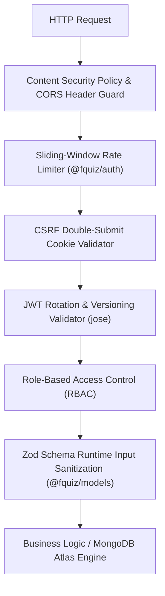

# 🛡️ FQuiz — Security Architecture Specification (`docs/SECURITY.md`)

> **Version**: 2.0.0 (Pure Symmetrical Monorepo Architecture)  
> **Managed Package**: `@fquiz/auth` (`packages/auth`)  
> **Standards**: Zero-Trust Security, Defense-in-Depth, Double-Submit CSRF, JWT Key Rotation, Sliding Window Rate Limiting.

---

## 1. Security Overview

FQuiz implements a **Zero-Trust** security architecture: every client request is treated as untrusted until verified through Edge Proxies, multi-tier authentication guards from `@fquiz/auth`, CSRF verification, and schema validation via Zod schemas from `@fquiz/models`.

---

## 2. Critical Security Mechanisms

### 2.1. JWT Authentication & Zero-Downtime Key Rotation
- The authentication engine utilizes `jose` to sign and verify JWTs across Node.js runtimes in `@fquiz/auth`.
- **Zero-Downtime Key Rotation**:
  - `JWT_SECRET`: Active secret key used to sign new tokens.
  - `JWT_SECRET_PREV`: Previous secret key preserved during rotation windows to accept earlier valid tokens.
  - Verification attempts `JWT_SECRET` first; if signature validation fails, it falls back to `JWT_SECRET_PREV` before rejecting.
- **Token Versioning & Instant Revocation**:
  - A `token_version` integer is stored on the `User` document and encoded in the JWT payload.
  - When a user changes their password or an administrator issues an account ban, the user's `token_version` increments by 1.
  - Existing sessions on all other devices are invalidated immediately (401 Unauthorized) without maintaining expensive distributed blocklists.

---

### 2.2. CSRF Defense: Double-Submit Cookie Pattern
- FQuiz enforces the **Double-Submit Cookie** pattern:
  1. Upon visiting the application, the server sets a `csrf-token` cookie (`httpOnly: false`, `sameSite: strict`, `secure: true` in production).
  2. Every client mutation request (`POST`, `PUT`, `PATCH`, `DELETE`) reads this value and transmits it in the `x-csrf-token` HTTP header.
  3. Edge Proxies (`apps/web/proxy.ts` and `apps/admin/proxy.ts`) compare the header against the cookie; any mismatch or missing value terminates the request with `403 Forbidden`.
- **Safe Exemptions**: Purely public endpoints without session dependency or internal cron triggers authenticated via pre-shared secret keys.

---

### 2.3. Sliding Window Rate Limiting
- The `@fquiz/auth` package provides an in-memory sliding window rate limiter tracking client IP addresses and User IDs.
- Mitigates denial-of-service (DoS) attempts, password brute-forcing, and unauthorized high-volume abuse of cost-intensive AI generation APIs.
- Rejections return HTTP `429 Too Many Requests` accompanied by standard RFC headers: `Retry-After`, `X-RateLimit-Limit`, and `X-RateLimit-Remaining`.

---

### 2.4. Content Security Policy (CSP)
- Enforced across `apps/web/next.config.js`, `apps/admin/next.config.js`, and `proxy.ts`:
  - `default-src 'self'`: Disallows external asset loading by default.
  - `script-src`: Restricts scripts, explicitly prohibiting `unsafe-eval` and unauthorized third-party embeds.
  - `img-src`: Restricts image loading to internal origins and domains explicitly declared in `ALLOWED_IMAGE_DOMAINS`.
  - `connect-src`: Binds API and OAuth communication strictly to validated application endpoints and Google OAuth.

---

### 2.5. Edge Proxies & Role-Based Access Control (RBAC)
- `apps/web/proxy.ts`: Isolates administrative routes on the web client, redirecting `/admin` requests to `NEXT_PUBLIC_ADMIN_URL` (`fquiz-admin.vercel.app`), and returning `404 Not Found` for `/api/admin/*`.
- `apps/admin/proxy.ts`: Zero-Trust RBAC Proxy rejecting non-admin/dev access with `403 Forbidden`.
- `withAuth` Higher-Order Function: Shields API route handlers with hierarchical role checks (`student` < `teacher` < `admin` < `dev`).
