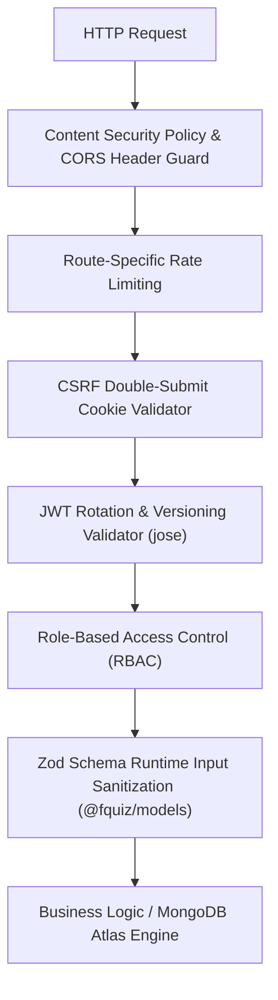

# 🛡️ FQuiz — Security Architecture Specification (`docs/SECURITY.md`)

> **Version**: 2.0.0 (Pure Symmetrical Monorepo Architecture)  
> **Managed Package**: `@fquiz/auth` (`packages/auth`)  
> **Standards**: Zero-Trust Security, Defense-in-Depth, Double-Submit CSRF, JWT Key Rotation, Sliding Window Rate Limiting.

---

## 1. Security Overview

FQuiz implements a **Zero-Trust** security architecture: every client request is treated as untrusted until verified through Edge Proxies, multi-tier authentication guards from `@fquiz/auth`, CSRF verification, and schema validation via Zod schemas from `@fquiz/models`.

---

## 2. Critical Security Mechanisms

### 2.1. JWT Authentication & Zero-Downtime Key Rotation
- The authentication engine utilizes `jose` to sign and verify JWTs across Node.js runtimes in `@fquiz/auth`.
- **Zero-Downtime Key Rotation**:
  - `JWT_SECRET`: Active secret key used to sign new tokens.
  - `JWT_SECRET_PREV`: Previous secret key preserved during rotation windows to accept earlier valid tokens.
  - Verification attempts `JWT_SECRET` first; if signature validation fails, it falls back to `JWT_SECRET_PREV` before rejecting.
- **Token Versioning & Revocation**:
  - A `token_version` integer is stored on the `User` document and encoded in the JWT payload.
  - Web and admin verification reject tokens without a positive integer version.
  - Password changes advance a valid version and set a missing or invalid legacy version to `2`; administrator role or status changes also advance the version so earlier tokens stop authorizing requests.
  - Admin API verification reads the current user record on each request. Web API verification caches status and version for up to 60 seconds, so another warm Web instance may accept a revoked token until its cache expires.
  - Admin login atomically sets a missing or invalid stored version to `2` before issuing a cookie, invalidating legacy version-1 cookies for that account. Existing positive versions are retained.

---

### 2.2. CSRF Defense: Double-Submit Cookie Pattern
- The Web proxy enforces the **Double-Submit Cookie** pattern:
  1. Upon visiting the application, the server sets a `csrf-token` cookie (`httpOnly: false`, `sameSite: strict`, `secure: true` in production).
  2. Every client mutation request (`POST`, `PUT`, `PATCH`, `DELETE`) reads this value and transmits it in the `x-csrf-token` HTTP header.
  3. The Web proxy (`apps/web/proxy.ts`) compares the header against the cookie; any mismatch or missing value terminates the request with `403 Forbidden`.
- The Admin proxy (`apps/admin/proxy.ts`) checks `Origin` or `Referer` against the request origin for cookie-authenticated mutations. Requests with a mismatched or missing source are rejected with `403`; bearer-token clients do not rely on ambient cookies.
- **Safe Exemptions**: Purely public endpoints without session dependency or internal cron triggers authenticated via pre-shared secret keys.

---

### 2.3. Route-Specific Rate Limiting
- `packages/auth/src/rate-limit.ts` uses an in-memory sliding-window counter for admin login. Its five-attempts-per-minute budget is local to each Node.js process.
- `apps/web/lib/core/security/rate-limit/sliding-window.ts` applies in-memory counters in the Web proxy. Those counters are also process-local and are not shared across serverless instances or regions.
- API routes that use `apps/web/lib/core/security/rate-limit/provider.ts` normally store fixed-window counters in MongoDB for sharing across instances. When MongoDB is unavailable, the provider falls back to a process-local memory counter, so the aggregate budget is not preserved during that fallback.
- The in-memory limiters derive the client address from forwarded IP headers. The current production Web and Admin projects use direct `*.vercel.app` domains. Vercel documents that it overwrites `X-Forwarded-For` with the public client IP to prevent spoofing; this trust statement assumes Vercel remains the outer proxy. If a reverse proxy is placed in front of Vercel, use a trusted custom header and update the application’s IP extraction accordingly ([Vercel request headers](https://vercel.com/docs/headers/request-headers), checked 2026-10-20).
- In-memory counters remain process-local even when the client IP is trusted. Use the existing MongoDB limiter or a shared edge store for routes whose budgets must aggregate across serverless instances.
- Rate-limit rejections return HTTP `429 Too Many Requests` with `Retry-After`, `X-RateLimit-Limit`, and `X-RateLimit-Remaining` headers. Configure a shared store or trusted edge limit where an aggregate budget is required.
- Six-digit email verification codes are stored as HMAC-SHA256 digests keyed by `JWT_SECRET`; production code hashing fails closed when that key is absent. Rotating `JWT_SECRET` invalidates outstanding verification codes, which users must request again.
- Failed verification attempts increment a per-code counter with an atomic limit predicate. This account/code budget complements the per-IP rate limit and is not a replacement for it.
- Password-reset requests return the same generic success status and body for unknown accounts, resend cooldowns, and mail delivery failures. Delivery failures are logged internally so the response does not disclose whether the account exists.
- Password-reset code verification returns the same generic invalid-or-expired response for missing, expired, incorrect, or locked codes, so the verification response does not reveal whether a reset code is active for an account.

---

### 2.4. Content Security Policy (CSP)
- Enforced across `apps/web/next.config.js`, `apps/admin/next.config.js`, and `proxy.ts`:
  - `default-src 'self'`: Disallows external asset loading by default.
  - `script-src`: Restricts scripts, explicitly prohibiting `unsafe-eval` and unauthorized third-party embeds.
  - `img-src`: Restricts image loading to internal origins and domains explicitly declared in `ALLOWED_IMAGE_DOMAINS`.
  - `connect-src`: Binds API and OAuth communication strictly to validated application endpoints and Google OAuth.

---

### 2.5. Edge Proxies & Role-Based Access Control (RBAC)
- `apps/web/proxy.ts`: Isolates administrative routes on the web client, redirecting `/admin` requests to `NEXT_PUBLIC_ADMIN_URL`, and returning `404 Not Found` for `/api/admin/*`.
- `apps/admin/proxy.ts`: Zero-Trust RBAC Proxy rejecting non-admin/dev access with `403 Forbidden`.
- `withAuth` Higher-Order Function: Shields API route handlers with hierarchical role checks (`student` < `teacher` < `admin` < `dev`).

### 2.6. OAuth, secrets, and account lifecycle
- Google sign-in accepts an ID token only when its `aud` exactly matches `NEXT_PUBLIC_GOOGLE_CLIENT_ID`. Callback destinations are resolved against the configured application origin and cross-origin destinations are rejected.
- Account recovery links use the configured application origin; Google sign-in and account deletion fail closed in production when no canonical URL is configured. Request `Host` and `X-Forwarded-Host` values do not choose these security-sensitive link origins.
- JWT signing requires `JWT_SECRET`; there is no source-code fallback. `JWT_SECRET_PREV` is accepted for verification during rotation. Verification-code HMACs use `JWT_SECRET` and fail closed when it is absent.
- Secret encryption uses `ENCRYPTION_KEY`, falling back to `JWT_SECRET` only when explicitly configured. Decryption can try `ENCRYPTION_KEY_PREV`, `ENCRYPTION_KEY_PREV_2`, and the current/previous JWT secrets to support key rotation. Operators must retain the key that encrypted existing values until those values are re-encrypted.
- Logout clears the current browser's authentication cookie. It does not revoke bearer tokens or log out other devices.
- Account deletion retains classroom memberships and grade/progress rows under a keyed pseudonymous student ID. Teacher-owned classrooms and assignments are archived and scrubbed of personal metadata. This cleanup requires a persistent `ANONYMIZATION_KEY` with at least 32 characters; deletion fails before cleanup if it is missing or too short. Configure the same key across instances before enabling account deletion with this retention policy.

### 2.7. Private content and bounded request handling
- Private or draft quiz content, comments, answer variants, and duplicate-code metadata are visible only to the quiz owner. Classroom assignments accept the owner's quiz or a public, published quiz. Student classroom responses omit the classroom password.
- Students can save and study public quizzes but cannot author or publish quizzes or request new categories. Quiz authoring and import preview require teacher/admin access; student category-request and create-from-pinned endpoints are removed.
- Student pinned-question listings use keyset pagination with a maximum of 50 visible items per response, backed by the `{ student_id, _id }` index; callers can request subsequent pages with the returned cursor. Category lookups scan pins and matching quiz codes in bounded batches.
- CSP reports are limited to 8192 request bytes, feedback to 5000 bytes, and quiz-import files to 2 MiB. These routes count streamed bytes before parsing; the import request also allows bounded multipart framing overhead.
- Feedback is limited to three accepted submissions per authenticated user in a rolling hour using a MongoDB-backed atomic quota. If the quota store cannot be used, the route fails closed. Personalized explore responses use `Cache-Control: private, no-store`.
