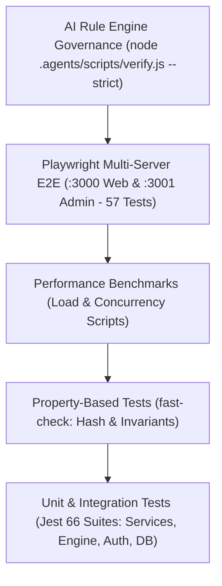

# 🧪 FQuiz — Testing Strategy & Quality Assurance (`docs/TESTING.md`)

This document outlines the testing strategy, test suite organization, mocking standards, performance benchmarks, and automated quality control enforced by the **AI Agent Rule Engine** for the **FQuiz** platform.

---

## 1. Testing Pyramid



---

## 2. Test Setup & Environment

- **Unit & Integration Runner**: `Jest` paired with `ts-jest` executing directly against the Node.js environment.
- **Path Mapping (`jest.config.ts`)**:
  - `^@/(.*)$`: `<rootDir>/apps/web/$1`
  - `^@fquiz/database$`: `<rootDir>/packages/database/src`
  - `^@fquiz/models$`: `<rootDir>/packages/models/src`
  - `^@fquiz/auth$`: `<rootDir>/packages/auth/src`
  - `^@fquiz/ui$`: `<rootDir>/packages/ui/src`
- **E2E Runner**: `Playwright` concurrently orchestrating both web servers (`apps/web` on `:3000` and `apps/admin` on `:3001`).
- **File Naming Conventions**: `**/__tests__/**/*.test.{ts,tsx}` or `e2e/**/*.spec.ts`.

---

## 3. Test Execution Commands

```bash
# 1. Run all 66 Unit & Integration test suites (Jest)
npm test

# 2. Run tests and generate code coverage report
npm run test:coverage

# 3. Run all 57 E2E tests (Playwright Multi-Server :3000 & :3001)
npx playwright test

# 4. Run Playwright with interactive visual UI mode
npx playwright test --ui

# 5. Run cross-application impact scenarios
npx playwright test "e2e/cross-app-impact.spec.ts"

# 6. Check TypeScript compiler across all 7 monorepo workspaces
npx turbo check-types

# 7. Execute AI Rule Engine Governance verifying 18 strict checks
node .agents/scripts/verify.js --strict
```

---

## 4. Mocking Standards

To maintain test isolation, fast execution times, and zero external network dependencies:

### 4.1. Mock Database Connection
```typescript
jest.mock('@/lib/core/db/mongodb', () => ({
  connectDB: jest.fn().mockResolvedValue(true)
}));
```

### 4.2. Mock Next.js Server & Headers
```typescript
jest.mock('next/server', () => ({
  NextResponse: {
    json: jest.fn((data, init) => ({
      status: init?.status || 200,
      json: async () => data
    }))
  }
}));
```

### 4.3. Mock withAuth Higher-Order Function
```typescript
jest.mock('@/lib/modules/auth/with-auth', () => ({
  withAuth: (handler: any) => (req: any, ctx: any) =>
    handler(req, {
      ...ctx,
      payload: { userId: 'mock-user-id', role: 'student' }
    })
}));
```

---

## 5. Property-Based Testing

The platform utilizes `fast-check` to empirically prove mathematical invariants across hashing and identifier generation algorithms:

- **Question ID Generator Invariant**: Ensures that arbitrary shuffling of choices in the `options` array never alters the generated SHA-256 identifier output by `generateQuestionId(text, options)`.
- **Fingerprint Invariant**: Proves that identical question stems, answer keys, subject codes, and curriculum categories always produce the exact same deterministic SHA-256 fingerprint.

---

## 6. Automated Quality Assurance via AI Agent Rule Engine

A custom rule verification engine runs locally before commits and within the GitHub Actions CI pipeline (`.github/workflows/ci.yml`):

```bash
# Execute governance rules in strict verification mode
node .agents/scripts/verify.js --strict
```

### 9 Mandatory Governance Rules:
1. `BUILD_TYPE_CHECK`: 100% pass on TypeScript compiler check across all packages (0 errors).
2. `CODE_QUALITY_SECURITY`: 0 hardcoded secrets, 0 security vulnerabilities (XSS, eval).
3. `CROSS_MODULE_BOUNDARY`: 0 cross-module model imports, 0 Mongoose `.populate()` calls.
4. `ESLINT_VALIDATION`: 100% adherence to ESLint TypeScript & security standards.
5. `FOLDER_STRUCTURE`: Guarantees complete layered monorepo directory topology.
6. `LINT_ISSUES`: 0 unused variables, 0 swallowed catch errors, 0 explicit `any` abuses.
7. `NO_MOCK_DATA`: 0 static mock objects in production runtime code.
8. `SKILLS_GOVERNANCE`: Validates integrity and documentation of Agent Skills in `.agents/skills/`.
9. `THEME_GOVERNANCE`: Enforces 3-Tier Design Tokens and WCAG 2.2 AA contrast compliance.
