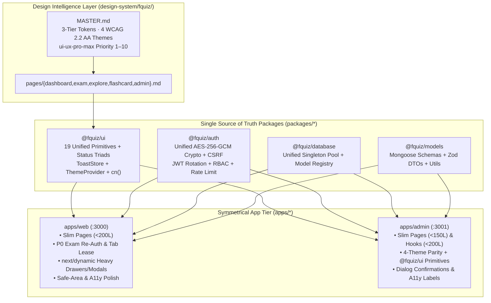

# FQuiz Repository Restructuring & `ui-ux-pro-max` Modernization Specification

> **Date:** 2026-10-16  
> **Status:** Approved for Autonomous Execution (`/goal`)  
> **Skills Applied:** `ui-ux-pro-max`, `fquiz-ui-ux-audit`, `fquiz-code-refactor-performance`, `fquiz-ui-theme`, `fquiz-gsap-ui-ux`, `fquiz-development-workflow`, `ponytail`

---

## 1. Executive Summary & Problem Statement

A comprehensive static and architectural audit of the FQuiz Turborepo monorepo (`apps/web`, `apps/admin`, `packages/*`) against `ui-ux-pro-max` and FQuiz governance standards revealed four structural bottlenecks:

1. **"Hollow Monorepo Syndrome" & Cross-App Drift**:
   - Although `@fquiz/ui`, `@fquiz/auth`, `@fquiz/database`, and `@fquiz/models` exist in `packages/*`, **`apps/web` and `apps/admin` have 0 runtime imports from `@fquiz/ui` and `@fquiz/auth`**, and `apps/web` has 0 imports from `@fquiz/database`.
   - **19 Shadcn UI primitives**, `cn()`, `toast-store`, and `ThemeProvider` are duplicated 3 ways across `packages/ui`, `apps/web/components/shared/ui`, and `apps/admin/components/ui`.
   - **Critical Security Drift Bug**: `apps/web/lib/core/security/crypto.ts` and `packages/auth/src/crypto.ts` resolve the AES-256-GCM key via `JWT_SECRET || ENCRYPTION_KEY || 'fquiz-llm-secret-encryption-key-2026-sin1'`, whereas `apps/admin/lib/security/crypto.ts` uses `ENCRYPTION_KEY || JWT_SECRET || 'fquiz-admin-encryption-key-2026'`. Consequently, LLM API keys encrypted via the Admin Portal cannot be decrypted by Web AI services when both or neither environment variables are set.
   - **Dual Model Registries**: `apps/web/lib/core/db/model-registry.ts` and `packages/database/src/model-registry.ts` maintain separate in-memory model registration arrays.
   - **Legacy Single-App Root Clutter**: Pre-monorepo files (`tailwind.config.ts`, `postcss.config.js`, `components.json`, `vercel.json`, `next-env.d.ts`) and 8 broken `scripts/*` entries in root `package.json` remain at the repository root, alongside 3 empty directories in `apps/web/components/`.

2. **P0/P1 Mission-Critical Exam Resilience & Integrity Gaps (`fquiz-ui-ux-audit`)**:
   - **Forbidden 401 Hard Redirects in Exam Rooms**: `useSubmitAnswer.ts`, `useSessionFinalize.ts`, and `useFlashcardSession.ts` execute `window.location.href = '/login?redirect=...'` upon HTTP `401`, destroying unsaved client exam state.
   - **AI Assistant Mounted in Exam Mode**: `SessionLayout.tsx` mounts `<QuizAIAssistantDrawer>` unconditionally even when `session.mode === 'review'` (Exam Mode).
   - **Missing Authoritative Multi-Tab Exam Lease**: Active exam sessions lack a `BroadcastChannel` multi-tab lease lock to prevent concurrent tab submission race conditions.

3. **Fat Pages, Oversized Hooks & Missing `next/dynamic` Code-Splitting (`fquiz-code-refactor-performance`)**:
   - **Oversized Pages (`> 200L` in Web, `> 150L` in Admin)**:
     - `apps/web/app/(teacher)/teacher/quizzes/page.tsx` (314L)
     - `apps/web/app/(auth)/login/page.tsx` (306L)
     - `apps/web/app/terms/page.tsx` (206L) & `apps/web/app/privacy/page.tsx` (205L)
     - `apps/admin/app/(dashboard)/settings/page.tsx` (166L) & `apps/admin/app/(dashboard)/page.tsx` (163L)
   - **Oversized Hooks (`> 200L` in Admin)**:
     - `apps/admin/hooks/quiz/useQuizFileUpload.ts` (408L)
     - `apps/admin/hooks/quiz/useQuizEditorForm.ts` (383L)
   - **Missing `next/dynamic` Lazy Loading**: Heavy drawers and modals (`QuizAIAssistantDrawer`, `MobileNavExamSheet`, `MobileNavUserSheet`, `AuthPromptModal`, `QuizEditorFileUploadModal`, `QuizEditorSyncConfirmModal`, `QuestionConflictModal`, etc.) are statically imported in initial page bundles.

4. **`ui-ux-pro-max` Priority 1–10 Accessibility, Touch Target, Safe-Area & Motion Gaps**:
   - Missing `env(safe-area-inset-bottom)` on `MobileSessionFooter.tsx` and `env(safe-area-inset-top)` on `MobileSessionHeader.tsx`.
   - Missing `aria-label` on icon-only buttons across `apps/admin` and `apps/web` mobile headers/navigators, missing `role="dialog"` / `aria-modal="true"` on mobile sheets, and blocking native `window.confirm()` in Admin user deletion.
   - Missing `gsap.matchMedia()` `(prefers-reduced-motion: no-preference)` guards in dashboard GSAP hooks (`LearningStudioGrid.tsx`, `RecentActivitiesFeed.tsx`, `IncompleteSessionBanner.tsx`).
   - Residual hardcoded Tailwind palette classes (`amber-*`, `emerald-*`) in Admin quiz editor components and `@fquiz/ui` `toast-provider.tsx`.

---

## 2. Architectural Design & Restructuring Pillars

### Pillar 1: Monorepo Package Unification & Root Hygiene
- **`@fquiz/ui` Canonicalization**:
  - Merge `success`, `warning`, `info`, and `attempted` semantic triad variants into `packages/ui/src/components/badge.tsx`.
  - Add `aria-hidden="true"` to decorative icons in `packages/ui/src/components/{dialog,select,dropdown-menu,checkbox}.tsx`.
  - Replace hardcoded `bg-emerald-500`, `bg-rose-500`, `bg-amber-500` in `packages/ui/src/toast/toast-provider.tsx` with semantic triad tokens.
  - Convert duplicated UI primitive files in `apps/web/components/shared/ui/*`, `apps/web/lib/core/utils/cn.ts`, `apps/admin/components/ui/*`, and `apps/admin/lib/utils/cn.ts` into clean re-exports of `@fquiz/ui`, ensuring **100% single-source execution from `@fquiz/ui`** while preserving every existing `@/components/...` import path across all 66 Jest test suites and app components.
  - Upgrade `apps/admin/app/globals.css` with all 4 WCAG 2.2 AA themes (`.light`, `.dark`, `.green`, `.pink`) and wrap `apps/admin/app/providers.tsx` with `ThemeProvider` from `@fquiz/ui`.
- **`@fquiz/auth` & `@fquiz/database` Unification**:
  - Update `packages/auth/src/crypto.ts` so `encryptSecret` / `decryptSecret` use a unified key derivation strategy with transparent fallback across `ENCRYPTION_KEY` and `JWT_SECRET`, and re-export `@fquiz/auth` from `apps/web/lib/core/security/crypto.ts` and `apps/admin/lib/security/crypto.ts`.
  - Delegate `apps/web/lib/core/db/{base-schema,model-registry}.ts` directly to `@fquiz/database` so `apps/web`, `apps/admin`, and `packages/models` share the exact same `model-registry` singleton.
- **Root & Dead-Folder Cleanup**:
  - Delete pre-monorepo root files: `tailwind.config.ts`, `postcss.config.js`, `components.json`, `vercel.json`, `next-env.d.ts`.
  - Delete empty directories in `apps/web`: `components/home`, `components/shared/landing`, `components/shared/utils`.
  - Clean dead `scripts/*` entries in root `package.json` and set root name to `"@fquiz/monorepo"`.

### Pillar 2: Mission-Critical Exam Resilience (`apps/web`)
- **Zero-Unload 401 Recovery**:
  - In `useSubmitAnswer.ts`, `useSessionFinalize.ts`, and `useFlashcardSession.ts`, replace `window.location.href = '/login...'` on 401 with `useAuthModalStore.getState().openModal('login')` and a toast warning so active exam answers in memory/localStorage are never lost.
- **Strict Exam Mode AI Disabling**:
  - In `SessionLayout.tsx`, load `QuizAIAssistantDrawer` via `next/dynamic(..., { ssr: false })` and render it **exclusively when `session.mode === 'practice'`**.
- **Authoritative Multi-Tab Exam Lease (`useExamTabLease.ts`)**:
  - Implement `apps/web/hooks/quiz/useExamTabLease.ts` using `BroadcastChannel` (`fquiz_exam_lease_${sessionId}`) to enforce single-tab authority during Exam (`review`) mode, rendering a non-destructive read-only banner with a *"Take over session here"* button when a duplicate tab is detected.

### Pillar 3: 3-Layer Code Decomposition & `next/dynamic` Optimization
- **`apps/admin` Decomposition (< 150L Pages, < 200L Hooks)**:
  - Extract `apps/admin/lib/utils/quiz-file-parser.ts` and `apps/admin/hooks/quiz/useQuizBankSync.ts` from `useQuizFileUpload.ts` (408L $\rightarrow < 180\text{L}$).
  - Extract `apps/admin/hooks/quiz/useCourseCodeCheck.ts` and `apps/admin/hooks/quiz/useQuestionListHandlers.ts` from `useQuizEditorForm.ts` (383L $\rightarrow < 190\text{L}$).
  - Extract `apps/admin/components/settings/LLMSettingsCard.tsx` from `apps/admin/app/(dashboard)/settings/page.tsx` (166L $\rightarrow < 110\text{L}$).
  - Extract `apps/admin/components/dashboard/RecentRegistrationsTable.tsx` (using `@fquiz/ui` `<Table>`) from `apps/admin/app/(dashboard)/page.tsx` (163L $\rightarrow < 110\text{L}$).
  - Extract `apps/admin/components/users/UserDeleteDialog.tsx` to replace native `window.confirm()` in `apps/admin/app/(dashboard)/users/page.tsx`.
  - Lazy-load `QuizEditorFileUploadModal`, `QuizEditorSyncConfirmModal`, and `QuestionConflictModal` in `QuizEditorWithQuestionBank.tsx` via `next/dynamic`.
- **`apps/web` Decomposition (< 200L Pages) & `next/dynamic` Bundles**:
  - Split `apps/web/app/(teacher)/teacher/quizzes/page.tsx` (314L $\rightarrow < 150\text{L}$) by extracting `components/teacher/quizzes/TeacherQuizGridCard.tsx` and `TeacherQuizFilterBar.tsx`.
  - Split `apps/web/app/(auth)/login/page.tsx` (306L $\rightarrow < 160\text{L}$) by extracting `components/auth/LoginHeroPanel.tsx`.
  - Split `apps/web/app/terms/page.tsx` (206L $\rightarrow < 95\text{L}$) and `apps/web/app/privacy/page.tsx` (205L $\rightarrow < 95\text{L}$) by moving static legal section data into `apps/web/lib/constants/legal-content.ts`.
  - Convert `MobileNavExamSheet`, `MobileNavUserSheet` in `MobileNav.tsx`, `AuthPromptModal` in `AppLayout.tsx`, `QuizResumeSessionModal` & `GuestHistoryReminderModal` in `QuizActionCard.tsx`, and `DeleteAccountModal` in `profile/page.tsx` to `next/dynamic(..., { ssr: false })`.

### Pillar 4: `ui-ux-pro-max` Accessibility, Safe-Area, Touch & GSAP Standards
- **Safe-Area & Mobile Ergonomics**:
  - `MobileSessionFooter.tsx`: Apply `pb-[max(0.75rem,env(safe-area-inset-bottom))]`.
  - `MobileSessionHeader.tsx`: Apply `pt-[env(safe-area-inset-top)]`, `h-11 w-11` (`44×44px`) touch targets, explicit `aria-label` + `aria-pressed`, and GPU `scaleX` progress bar transform.
  - `MobileNav.tsx`, `MobileNavExamSheet.tsx`, `MobileNavUserSheet.tsx`: Apply `pb-[max(0.75rem,env(safe-area-inset-bottom))]` and `role="dialog" aria-modal="true"`.
- **Screen Reader & Icon Accessibility**:
  - Add descriptive `aria-label` and `aria-current="step"` to question matrix buttons in `QuizSidebar.tsx` and `InteractiveResultViewer.tsx`.
  - Add `role="radio"` / `role="checkbox"` and `aria-checked` to `MobileSessionQuestionCard.tsx`.
  - Add `aria-label` to all icon-only buttons across `apps/admin` (`AdminHeader`, `CategoryList`, `UserTable`, `QuizTable`, `FeedbackList`, `QuestionBankStatus`, `QuestionBankAnalytics`, `QuizEditorHeader`, `QuizEditorFileUploadModal`, `QuizEditorQuestionCard`) and replace raw `amber-*`/`emerald-*`/`text-success-text` classes with semantic Warning/Success Triad tokens.
- **GSAP Reduced-Motion Compliance**:
  - Add `gsap.matchMedia()` `(prefers-reduced-motion: no-preference)` guards to `LearningStudioGrid.tsx`, `RecentActivitiesFeed.tsx`, and `IncompleteSessionBanner.tsx`.

---

## 3. Verification & Quality Gate Criteria

Every task and the final repository state must pass:
1. `npm run lint` — 0 errors across `apps/web`, `apps/admin`, and `packages/*`.
2. `npm run check-types` — 0 TypeScript errors across all workspaces.
3. `npm test` — 100% of Jest unit and integration test suites passing.
4. `node .agents/scripts/verify.js --strict` — All 18 governance & WCAG 2.2 AA 3-Tier Theme checks passing with 0 errors and 0 warnings.
